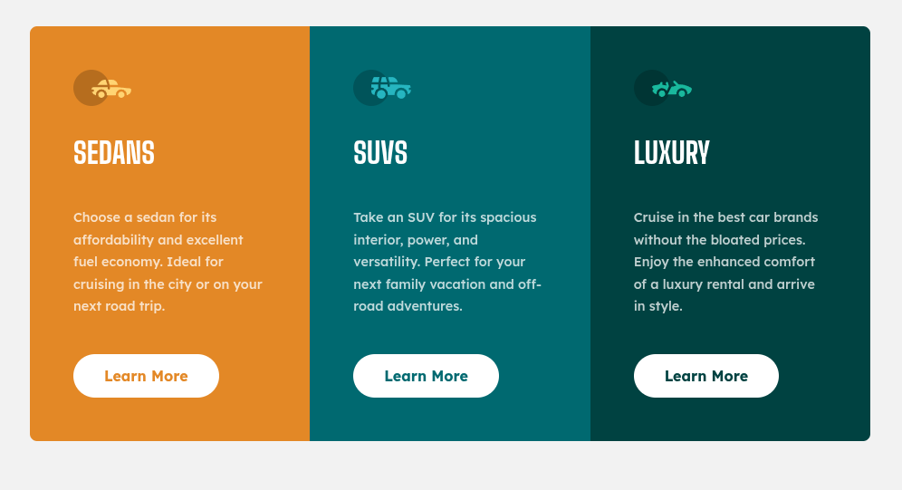

 <h1 align="center">

This is my solution to the [3 Column Preview Card Component](https://www.frontendmentor.io/challenges/3column-preview-card-component-pH92eAR2-) challenge.

</h1>

<div align="center">

## Preview




## Links

[View Live Project](https://yovanidosh.github.io/FmSoLuTiOns/challenges/3-column-preview-card-component-main/)

## Technologies Used

</div>

- HTML5
- CSS3
- CSS Grid
- Flexbox
- BEM
- Media Queries
- Mobile-first

<div align="center">

## Overview

</div>

The goal was to build a responsive component featuring three vehicle cards.

The interface includes:

- Sedans.
- SUVs.
- Luxury.
- Decorative icons.
- Descriptive text.
- "Learn More" buttons.
- A mobile-first layout.
- Three columns on desktop screens.

<div align="center">

## What I Learned

</div>

In this project, I learned how to:

- Create component variants using BEM.
- Use Flexbox within each card.
- Align buttons with `margin-top: auto`.
- Build a mobile-first layout.
- Transition from a single-column layout to three columns.
- Use `minmax()` in CSS Grid.
- Create buttons with `:hover` states.
- Use `:focus-visible` for accessible focus indicators.
- Keep decorative icons out of the accessibility tree.
- Reuse the same structure with different colors.

<div align="center">

## Featured Code

</div>

### Aligning Buttons with Flexbox

```css
.vehicle-card {
  display: flex;
  flex-direction: column;
}

.vehicle-card__button {
  margin-top: auto;
}
```

This technique keeps the buttons aligned at the bottom of each card, even when the cards contain different amounts of text.

<div align="center">

## Accessibility

</div>

The project includes:

- Semantic HTML.
- Decorative icons with `alt=""`.
- `aria-hidden="true"` for decorative elements.
- `:focus-visible` states.
- Keyboard navigation.
- A mobile-first approach.
- Media queries for responsive layouts.

<div align="center">

## Responsive Design

</div>

On mobile devices, the cards are stacked vertically.

On larger screens, they are displayed in three columns using CSS Grid.

<div align="center">

## Author

[Frontend Mentor](https://www.frontendmentor.io/profile/YovaniDosh)

[LinkedIn](https://www.linkedin.com/in/johanxt/)

</div>