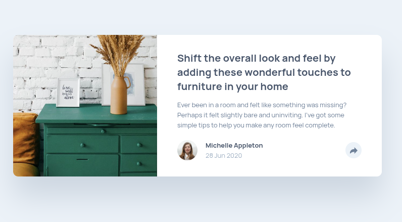

<h1 align="center">

This is my solution to the [Article Preview Component](https://www.frontendmentor.io/challenges/article-preview-component-dYBN_pYFT) challenge.

</h1>

<div align="center">

## Preview



</div>

<div align="center">

## Overview

</div>

The goal was to build a responsive card for presenting an article and displaying social links through an interactive button.

The interface includes:

- Main article image.
- Title and description.
- Author information and publication date.
- Button to show or hide the sharing options.
- Links to Facebook, Twitter, and Pinterest.
- Responsive layout for mobile and desktop devices.

<div align="center">

## Links

[View Live Project](https://yovanidosh.github.io/FmSoLuTiOns/challenges/article-preview-component-master/)

## Technologies Used

</div>

- HTML5
- CSS3
- JavaScript
- CSS Grid
- Flexbox
- Media queries
- SVG

<div align="center">

## What I Learned

</div>

In this project, I learned how to:

- Create a semantic card using `<article>`.
- Use `<time>` to represent a publication date.
- Communicate a menu's state using `aria-expanded` and `aria-controls`.
- Change the sharing panel's position according to the available screen width.
- Close a popover interface when pressing `Escape` or clicking outside the card.
- Manage focus after closing the panel using the keyboard.
- Combine CSS Grid and Flexbox in a responsive component.

<div align="center">

## Featured Code

</div>

### Sharing Panel Control

```javascript
shareButton.addEventListener('click', () => {
  const isExpanded =
    shareButton.getAttribute('aria-expanded') === 'true';

  if (isExpanded) {
    closeShareMenu();
    return;
  }

  openShareMenu();
});
```

The button checks its accessible state before deciding whether to open or close the panel. The functions keep the visible content, label, and `aria-expanded` attribute synchronized.

<div align="center">

## Accessibility

</div>

The project includes:

- Semantic HTML.
- Useful alternative text for the main image and avatar.
- A native button that supports keyboard interaction.
- Dynamic state management using `aria-expanded`.
- A relationship with the panel through `aria-controls`.
- Accessible names for social links.
- `:focus-visible` states.
- Closing the panel with the `Escape` key and restoring focus.

<div align="center">

## Responsive Design

</div>

On mobile devices:

- The image appears above the content.
- The sharing panel occupies the bottom area of the card.
- The content maintains appropriate spacing from widths of 320px upward.

On desktop screens:

- The card uses a two-column CSS Grid layout.
- The image occupies the full height of the first column.
- The sharing options appear in a floating panel with a visual pointer.

<div align="center">

## Author

[Frontend Mentor](https://www.frontendmentor.io/profile/YovaniDosh)

[LinkedIn](https://www.linkedin.com/in/johanxt/)

</div>