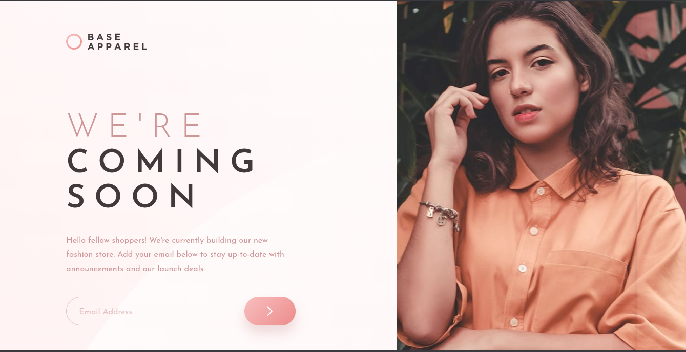

<div align="center">

<h1 align="center">
  My Solution to the <a href="https://www.frontendmentor.io/challenges/base-apparel-coming-soon-page-5d4b587da5b2c9000d001264">Base Apparel Coming Soon Page</a> Challenge
</h1>

## Preview



## Links

[View Live Project](https://yovanidosh.github.io/FmSoLuTiOns/challenges/base-apparel-coming-soon-master/)

## Technologies Used

</div>

- HTML5
- CSS3
- JavaScript
- CSS Grid
- Flexbox
- Media Queries
- CSS Custom Properties
- BEM Methodology
- Native HTML Form Validation
- Responsive Images with `<picture>`
- Variable Fonts with `@font-face`

<div align="center">

## Overview

</div>

The goal was to build a fully responsive coming-soon landing page with email validation.

The interface includes:

- The Base Apparel logo.
- Responsive images for mobile and desktop.
- A coming-soon announcement.
- An email subscription form.
- Validation for empty fields and invalid email addresses.
- Visual error states.
- A mobile-first layout.
- A two-column composition on desktop screens.

<div align="center">

## What I Learned

</div>

Through this project, I learned how to:

- Build a landing page using a mobile-first approach.
- Use `<picture>` to load different images depending on the available viewport width.
- Combine CSS Grid with a simple semantic HTML structure.
- Use `clamp()` to create fluid typography.
- Integrate an input field visually with its submit button.
- Use the native validation API through `validity.valid`.
- Display error messages with `aria-live`.
- Communicate invalid input using `aria-invalid`.
- Return focus to the field that requires attention.
- Create accessible `:hover`, `:active`, and `:focus-visible` states.
- Respect `prefers-reduced-motion` when defining transitions.
- Follow the BEM methodology for CSS class naming.
- Load a local variable font using `@font-face`.

<div align="center">

## Featured Code

</div>

### Accessible Email Validation

```javascript
if (!emailInput.validity.valid) {
  showError();
  emailInput.focus();
  return;
}
```

The native HTML validation API checks whether the field is empty or contains a value that does not match a valid email format.

The error-handling function updates both the interface and the field's accessible state:

```javascript
function showError() {
  form.classList.add("has-error");
  emailInput.setAttribute("aria-invalid", "true");
  errorMessage.textContent = "Please provide a valid email";
}
```

This keeps the red border, error icon, and message announced by assistive technologies synchronized.

<div align="center">

## Accessibility

</div>

The project includes:

- Semantic HTML.
- A correct heading hierarchy.
- A label associated with the email input.
- Dynamic messages announced through `aria-live`.
- `aria-invalid` to communicate validation errors.
- An accessible name for the submit button.
- Meaningful alternative text for informative images.
- Decorative elements hidden with `aria-hidden`.
- Visible keyboard focus states.
- Support for `prefers-reduced-motion`.

<div align="center">

## Responsive Design

</div>

The project follows a mobile-first approach.

**On mobile devices:**

- The logo, image, content, and form are arranged in a single column.
- The content remains centered.
- The mobile image spans the available width.
- The form adapts to its container's width.

**On desktop screens:**

- The layout changes to a two-column grid.
- The content appears over a decorative background pattern.
- The desktop image fills the height of the second column.
- The text and form are left-aligned.

<div align="center">

## Author

[Frontend Mentor](https://www.frontendmentor.io/profile/YovaniDosh)

[LinkedIn](https://www.linkedin.com/in/johanxt/)

</div>