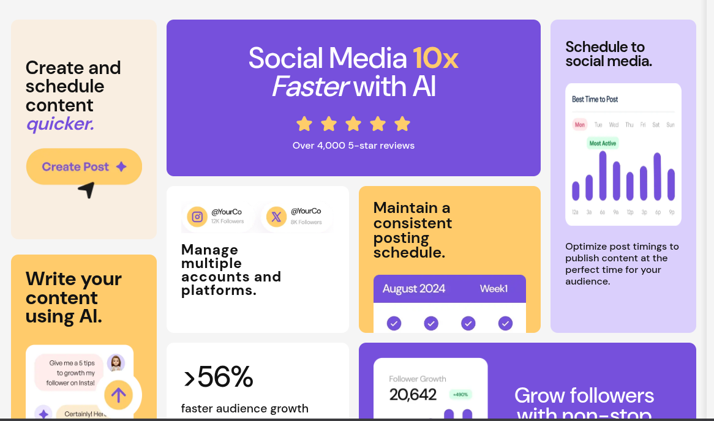

<h1 align="center">

This is my solution to the [Bento Grid](https://www.frontendmentor.io/challenges/bento-grid-RMydElrlOj) challenge.

</h1>

<div align="center">

## Preview



</div>

<div align="center">

## Overview

</div>

The goal was to build a fully responsive Bento Grid layout.

The interface includes:

- Eight cards with different sizes and proportions.
- Social content and statistics.
- Cards distributed across different rows and columns.
- Images that adapt to or intentionally overflow their containers.
- A mobile-first layout.
- Complete layout rearrangement for desktop screens.

<div align="center">

## Links

[View Live Project](https://yovanidosh.github.io/FmSoLuTiOns/challenges/bento-grid-main/)

## Technologies Used

</div>

- Semantic HTML
- Sass
- CSS Grid
- Responsive design
- Mobile-first design
- BEM methodology
- Media queries
- npm

<div align="center">

## What I Learned

</div>

In this project, I learned how to:

- Build a Bento layout using CSS Grid.
- Use `grid-template-areas`.
- Assign positions using `grid-area`.
- Create cards that span multiple columns.
- Create cards that span multiple rows.
- Use `minmax()` to control flexible sizes.
- Completely rearrange a layout without changing the HTML.
- Design a single-column mobile layout first.
- Transform the layout into a complex desktop composition.
- Compare Sass and Less variable syntax.
- Separate styles using partials.
- Use nesting in a controlled way.
- Use `clamp()` for fluid typography.
- Use `aspect-ratio`.
- Control images that intentionally extend beyond their containers.
- Use `max-width: none`.
- Clip content using `overflow: hidden`.
- Maintain a consistent BEM structure.
- Avoid changing the semantic HTML order for purely visual reasons.
- Use npm to compile Sass.

<div align="center">

## Featured Code

</div>

### Grid Areas

```scss
.bento {
  grid-template-areas:
    "create social social timing"
    "create accounts schedule timing"
    "ai audience growth growth";
}
```

Each name represents a region of the grid.

Each card is then assigned to its corresponding area:

```scss
.card--social {
  grid-area: social;
}

.card--timing {
  grid-area: timing;
}
```

This makes it possible to visualize the layout structure directly in the CSS.

<div align="center">

## Accessibility

</div>

The project includes:

- Semantic HTML.
- Use of `<main>` and `<article>`.
- Decorative images marked with `aria-hidden`.
- Heading hierarchy.

<div align="center">

## Responsive Design

</div>

The project was built following a mobile-first strategy.

On mobile devices:

- All cards appear in a single column.
- Each element maintains a natural reading order.
- Images adapt to the available space.

On desktop screens:

- The layout changes to a Bento grid.
- Some cards span multiple columns.
- `grid-template-areas` controls the overall composition.
- Images maintain the proportions defined by the design.

<div align="center">

## Author

[Frontend Mentor](https://www.frontendmentor.io/profile/YovaniDosh)

[LinkedIn](https://www.linkedin.com/in/johanxt/)

</div>