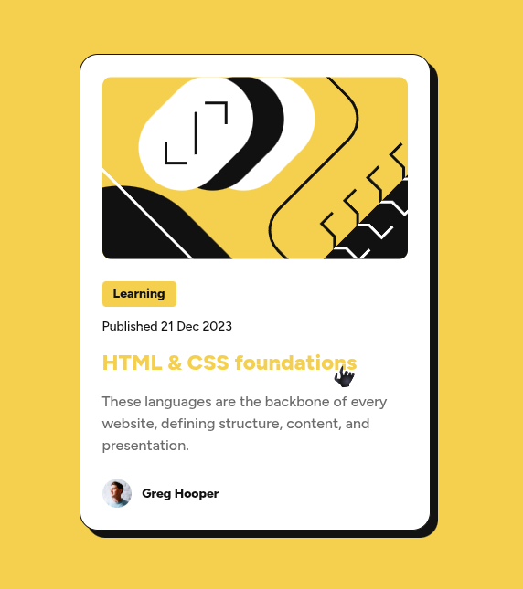

<h1 align="center">

This is my solution to the [Blog Preview Card](https://www.frontendmentor.io/challenges/blog-preview-card-ckPaj01IcS) challenge.

</h1>

## Preview

[View Live Project](https://yovanidosh.github.io/FmSoLuTiOns/challenges/blog-preview-card-main/)

## Technologies Used

- Semantic HTML5
- CSS
- Flexbox
- CSS Variables
- Mobile-first design
- Responsive design
- BEM methodology

## What I Learned

- Organizing classes using the BEM methodology.
- Separating a component into a block and its elements.
- Creating a solid offset shadow.
- Applying interactive states with `:hover`.
- Using a local variable font.
- Building a mobile-first component.

## Author

[Frontend Mentor](https://www.frontendmentor.io/profile/YovaniDosh)

[LinkedIn](https://www.linkedin.com/in/johanxt/)

