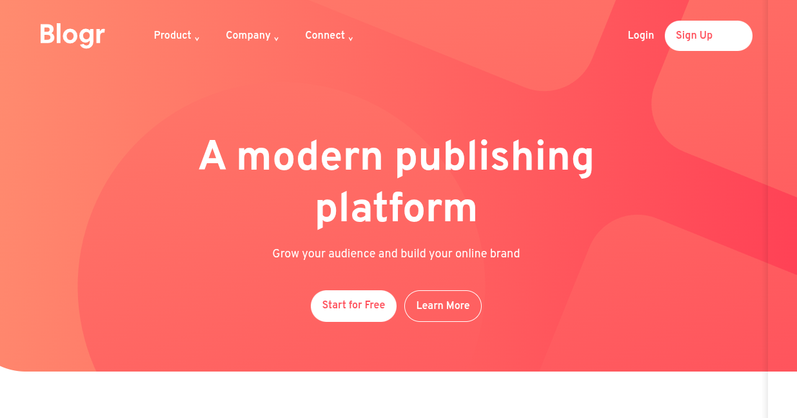

<div align="center">

<h1 align="center">
  My Solution to the <a href="https://www.frontendmentor.io/challenges/blogr-landing-page-EX2RLAApP">Blogr Landing Page</a> Challenge
</h1>

## Preview



## Links

[View Live Project](https://yovanidosh.github.io/FmSoLuTiOns/challenges/blogr-landing-page-main/)

## Technologies Used

</div>

- HTML5
- CSS3
- JavaScript
- Sass (SCSS)
- CSS Grid
- Flexbox
- Media Queries
- CSS Custom Properties
- Responsive Images with `<picture>`
- Variable Fonts with `@font-face`
- Accessible Navigation with ARIA

<div align="center">

## Overview

</div>

The goal was to build a fully responsive editorial landing page with accessible dropdown navigation.

The interface includes:

- A main navigation bar with three dropdown menus.
- A mobile menu controlled by JavaScript.
- A hero section with calls to action.
- An editorial features section.
- An infrastructure section with an overlapping illustration.
- A tools section with responsive images.
- A responsive footer with multiple groups of links.
- A mobile-first layout.
- Two-column layouts for desktop screens.

<div align="center">

## What I Learned

</div>

Through this project, I learned how to:

- Build a long-form landing page using a mobile-first approach.
- Control dropdown menus through `aria-expanded`.
- Prevent keyboard access to hidden navigation using `inert`.
- Close the menu with the `Escape` key and return focus to the toggle button.
- Adapt navigation when switching between mobile and desktop layouts.
- Use `<picture>` to serve illustrations tailored to the viewport.
- Create editorial layouts with CSS Grid.
- Position illustrations outside their containers without causing horizontal overflow.
- Keep dropdown buttons centered while their arrow indicators change state.
- Organize styles and variants using Sass nesting.
- Load a local variable font with `@font-face`.

<div align="center">

## Featured Code

</div>

### Accessible, Responsive Navigation

```javascript
function setMenu(open) {
  menuToggle.setAttribute("aria-expanded", String(open));
  menu.toggleAttribute("inert", !open && !desktopMedia.matches);
}
```

The `aria-expanded` attribute communicates the menu's state to assistive technologies, while `inert` prevents hidden navigation links from receiving keyboard focus.

The viewport change handler keeps desktop navigation available:

```javascript
desktopMedia.addEventListener("change", (event) => {
  menu.toggleAttribute("inert", !event.matches);
});
```

This prevents the closed mobile menu state from blocking access to navigation links when the viewport expands to desktop size.

<div align="center">

## Accessibility

</div>

The project includes:

- Semantic HTML.
- A proper heading hierarchy.
- Native buttons for opening dropdown menus.
- `aria-expanded` to communicate interactive states.
- `inert` for hidden content.
- Navigation that can be closed using the `Escape` key.
- Focus returned to the menu toggle button.
- Visible keyboard focus states.
- Meaningful alternative text for informative images.
- Empty alternative text for decorative images.
- Support for `prefers-reduced-motion`.

<div align="center">

## Responsive Design

</div>

The project follows a mobile-first approach.

**On mobile devices:**

- Navigation appears inside a dropdown panel.
- Link groups expand vertically.
- Content and illustrations are arranged in a single column.
- Sections remain centered.
- Footer links are arranged vertically.

**On desktop screens:**

- Navigation switches to a horizontal layout.
- Dropdown menus appear below their respective buttons.
- The Future and Tooling sections use two-column layouts.
- The Infrastructure illustration extends beyond its background section.
- The footer distributes its link groups across four columns.

<div align="center">

## Author

[Frontend Mentor](https://www.frontendmentor.io/profile/YovaniDosh)

[LinkedIn](https://www.linkedin.com/in/johanxt/)

</div>