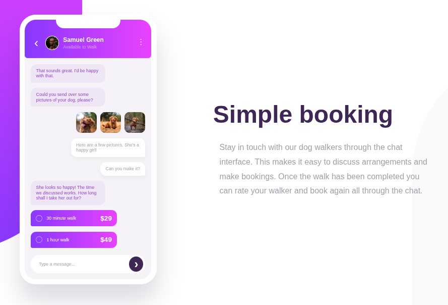

<div align="center">

<h1 align="center">
  My Solution to the <a href="https://www.frontendmentor.io/challenges/chat-app-css-illustration-O5auMkFqY">Chat App CSS Illustration</a> Challenge
</h1>

## Preview



## Links

[View Live Project](https://yovanidosh.github.io/FmSoLuTiOns/challenges/chat-app-css-illustration-master/)

## Technologies Used

</div>

- HTML5
- CSS3
- Flexbox
- CSS Grid
- CSS Custom Properties
- Media Queries
- Mobile-First Design

<div align="center">

## Overview

</div>

The goal was to build a responsive landing page featuring a visual representation of a mobile chat application.

The project includes:

- A phone interface built with HTML and CSS.
- A conversation with sent and received messages.
- An image gallery.
- Dog-walking service options.
- Gradients and decorative shapes.
- A responsive layout for mobile and desktop screens.

<div align="center">

## What I Learned

</div>

Through this project, I learned how to:

- Build a mobile interface within a landing page.
- Combine CSS Grid and Flexbox to create structured layouts.
- Position messages individually using `align-self`.
- Create decorative shapes using CSS.
- Work with gradients to enhance the visual design.
- Use `aspect-ratio` for images and circular elements.
- Position decorative elements with `position: absolute`.
- Adapt a complex composition using media queries.
- Maintain a mobile-first development strategy.

<div align="center">

## Featured Code

</div>

### Chat Message Alignment and Gradient Styling

```css
.message--received {
  align-self: flex-start;
}

.message--sent {
  align-self: flex-end;
}

.walk-option {
  background: linear-gradient(
    to right,
    var(--color-gradient-start),
    var(--color-gradient-end)
  );
}
```

Using `align-self`, I positioned individual messages within their Flexbox container to visually distinguish incoming and outgoing messages. The gradient creates a smooth color transition for the walking service options while keeping the design consistent through CSS custom properties.

<div align="center">

## Accessibility

</div>

The project includes:

- Semantic HTML.
- Alternative text for informative images.
- Decorative elements hidden from screen readers when appropriate.
- Buttons with accessible names through `aria-label`.
- A clear heading hierarchy.

<div align="center">

## Responsive Design

</div>

The project follows a mobile-first approach.

**On mobile devices**, the phone illustration and page content are arranged vertically to fit smaller screens.

**On desktop screens**, the composition switches to a two-column layout using CSS Grid, creating a balanced presentation between the phone interface and the introductory content.

<div align="center">

## Author

[Frontend Mentor](https://www.frontendmentor.io/profile/YovaniDosh)

[LinkedIn](https://www.linkedin.com/in/johanxt/)

</div>