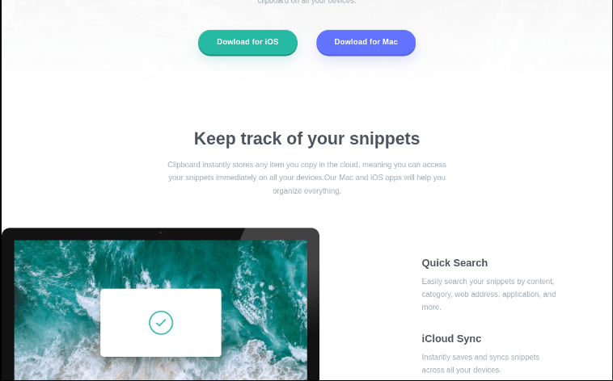

<h1 align="center">

This is my solution to the [Clipboard Landing Page](https://www.frontendmentor.io/challenges/clipboard-landing-page-82y9qDgXD) challenge.

</h1>

<div align="center">

## Preview



</div>

<div align="center">

## Overview

</div>

The goal was to build a responsive landing page for a clipboard application.

The page includes:

- Main hero section.
- Download buttons for iOS and Mac.
- Snippet tracking section.
- Desktop image.
- Feature list.
- Cross-device access section.
- Company logos.
- Footer with navigation and social media links.

<div align="center">

## Links

[View Live Project](https://yovanidosh.github.io/FmSoLuTiOns/challenges/clipboard-landing-page-master/)

## Technologies Used

</div>

- Less
- CSS Grid
- Flexbox
- Media queries
- npm
- Responsive design
- Mobile-first design

<div align="center">

## What I Learned

</div>

In this project, I learned how to:

- Continue working with Less using npm.
- Organize a large landing page with separate style files.
- Create reusable variables using `@`.
- Create mixins.
- Reuse patterns through mixins.
- Use nesting in components and sections.
- Create visual effects using `fade()`.
- Create a reusable button system within the project.
- Design complete sections using CSS Grid.
- Allow an image to partially extend beyond its container.
- Use `transform: translateX()`.
- Build a responsive logo section.
- Create a responsive footer.
- Avoid unnecessary media queries.
- Maintain semantic hierarchy with `<header>`, `<main>`, `<section>`, `<article>`, and `<footer>`.
- Create `:hover`, `:focus-visible`, and `:active` states.
- Maintain accessibility for links and decorative icons.

<div align="center">

## Featured Code

</div>

### Container Mixin

```less
.section-container() {
  width: min(100% - 2rem, 70rem);
  margin-inline: auto;
}
```

It can then be reused as follows:

```less
.section {
  .section-container();
}
```

This avoids repeating the same rules across multiple sections.

### Transparency with Less

```less
box-shadow:
  0 0 0.75rem 1.5rem
  fade(@color-green, 20%);
```

The `fade()` function creates a transparent version of an existing color.

### Responsive Layout

```less
@media (min-width: @breakpoint-tablet) {
  .workflow {
    grid-template-columns:
      repeat(3, minmax(0, 1fr));
  }
}
```

The page starts with a single-column layout and switches to three columns when enough space is available.

<div align="center">

## Accessibility

</div>

The project includes:

- Semantic HTML.
- Descriptive alternative text.
- Decorative icons marked with `aria-hidden`.
- Keyboard navigation.
- `:focus-visible` states.
- Functional links implemented with `<a>`.
- `aria-label` attributes for social media links.

<div align="center">

## Responsive Design

</div>

The project was built following a mobile-first strategy.

On mobile devices:

- Buttons are stacked vertically.
- Sections are displayed in a single column.
- Feature items are centered.
- Logos are displayed vertically.
- The footer is arranged in a column.

On larger screens:

- Buttons appear in a row.
- The Keep Track section switches to two columns.
- The desktop image extends slightly beyond its container.
- The Workflow section uses three columns.
- Logos appear horizontally.
- The footer switches to a horizontal layout.

<div align="center">

## Author

[Frontend Mentor](https://www.frontendmentor.io/profile/YovaniDosh)

[LinkedIn](https://www.linkedin.com/in/johanxt/)

</div>