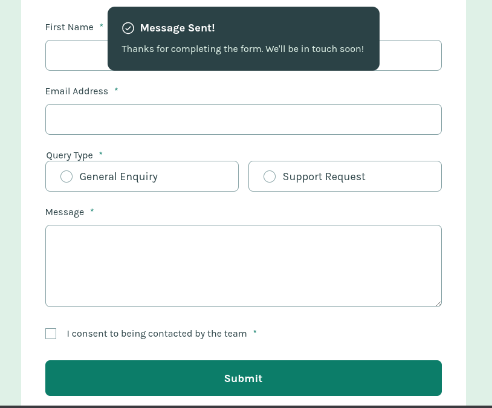

 <h1 align="center">

This is my solution to the [Contact Form ](https://www.frontendmentor.io/challenges/contact-form--G-hYlqKJj) challenge.

</h1>

<div align="center">

## Preview



## Links

[View Live Project](https://yovanidosh.github.io/FmSoLuTiOns/challenges/contact-form-main/)

## Technologies Used

</div>

- HTML5
- CSS3
- JavaScript
- CSS Grid
- Flexbox
- Form validation
- Local variable font

<div align="center">

## Overview

</div>

The goal was to build a responsive contact form with accessible validation, custom controls, and submission confirmation.

The interface includes:

- First name, last name, and email fields.
- Two query types with single selection.
- A message textarea.
- Required consent checkbox.
- Specific error messages for each validation issue.
- A confirmation message after a valid submission.

<div align="center">

## What I Learned

</div>

In this project, I learned how to:

- Build a form using native HTML controls.
- Group related options with `fieldset` and `legend`.
- Associate error messages with fields using `aria-describedby`.
- Communicate invalid fields using `aria-invalid`.
- Distinguish an empty email field from an incorrectly formatted address.
- Focus the first invalid field after submission.
- Customize radio buttons and checkboxes while preserving keyboard accessibility.
- Announce successful submission using a `role="status"` region.

<div align="center">

## Featured Code

</div>

### Validation and focusing the first invalid field

```javascript
const textResults = textFields.map(validateTextField);
const isQueryValid = validateQueryType();
const isConsentValid = validateConsent();
const isFormValid =
  textResults.every(Boolean) && isQueryValid && isConsentValid;

if (!isFormValid) {
  contactForm.querySelector('[aria-invalid="true"]').focus();
  return;
}
```

Each validation function returns a boolean result. If any validation fails, focus moves to the first invalid control, helping users locate and correct the issue without having to search for it visually.

<div align="center">

## Accessibility

</div>

The project includes:

- Explicitly associated labels for form fields.
- `autocomplete` attributes for personal information.
- Related options grouped with `fieldset` and `legend`.
- Error messages associated through `aria-describedby`.
- Invalid states communicated through `aria-invalid`.
- Full keyboard navigation.
- Visible focus indicators.
- Submission confirmation announced through `role="status"`.
- Native controls preserved while applying custom styling.
- Support for `prefers-reduced-motion`.

<div align="center">

## Responsive Design

</div>

On mobile devices:

- All fields are arranged in a single column.
- Query options are stacked vertically.
- The message area has a larger height to make typing easier.

On tablets and desktops:

- First name and last name share a row.
- Query options are displayed in two columns.
- The form maintains a maximum width and remains centered.
- The message area uses a more compact height.

<div align="center">

## Author

[Frontend Mentor](https://www.frontendmentor.io/profile/YovaniDosh)

[LinkedIn](https://www.linkedin.com/in/johanxt/)

</div>