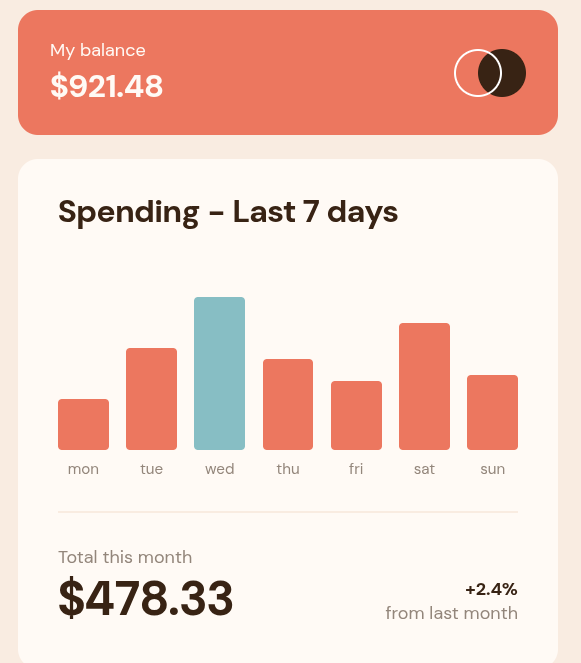

<h1 align="center">

This is my solution to the [Expenses Chart Component ](https://www.frontendmentor.io/challenges/expenses-chart-component-e7yJBUdjwt)challenge.
</h1>

<div align="center">

## Preview



## Links

[View Live Project](https://yovanidosh.github.io/FmSoLuTiOns/challenges/expenses-chart-component-main/)

## Technologies Used

</div>

- HTML5
- Less
- CSS3
- JavaScript
- Fetch API
- JSON
- CSS Grid
- Flexbox

<div align="center">

## Overview

</div>

The goal was to build a responsive component that displays expenses for the last seven days using data from a local JSON file.

The interface includes:

- A card displaying the available balance.
- A dynamically generated bar chart.
- Tooltips displaying each day's expense amount.
- A monthly spending summary and comparison with the previous month.

<div align="center">

## What I Learned

</div>

- Fetching local data using the Fetch API.
- Normalizing values to calculate proportional bar heights.
- Converting LESS variables and nested rules into standard CSS.
- Making an interactive chart accessible through buttons and descriptive accessible names.
- Displaying tooltips with both pointer interaction and keyboard navigation.
- Handling loading states and data retrieval errors.

<div align="center">

## Featured Code

</div>

### Dynamic bar heights and accessible labels

```javascript
const height = (amount / highestAmount) * 100;

bar.style.setProperty("--bar-height", `${height}%`);
bar.setAttribute("aria-label", `${dayNames[day]}: $${amount.toFixed(2)}`);
```

Each expense is compared with the highest value to calculate a proportional bar height. Each button also provides an accessible name containing the corresponding day and exact expense amount.

<div align="center">

## Accessibility

</div>

- Semantic HTML with headings and a list for chart data.
- Keyboard-operable chart bars.
- Accessible names containing the full day and expense amount.
- Loading and error messages communicated through `role="status"`.
- Visible hover and keyboard focus states.
- Support for `prefers-reduced-motion`.
- Additional context describing the chart for assistive technologies.

<div align="center">

## Responsive Design

</div>

On mobile devices, the bars and labels scale to preserve all seven columns, including at viewport widths of 320 pixels.

On tablets and desktops, the cards gain additional spacing, the chart becomes taller, and the summary values increase in size.

<div align="center">

## Author

[Frontend Mentor](https://www.frontendmentor.io/profile/YovaniDosh)

[LinkedIn](https://www.linkedin.com/in/johanxt/)

</div>