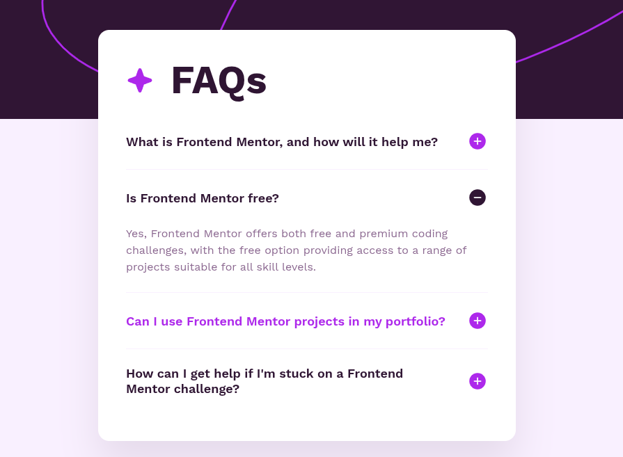

 <h1 align="center">

My solution to the [FAQ Accordion ](https://www.frontendmentor.io/challenges/faq-accordion-wyfFdeBwBz)challenge.

</h1>

<div align="center">

## Preview



## Links

[View Live Project](https://yovanidosh.github.io/FmSoLuTiOns/challenges/faq-accordion/)

## Technologies Used

</div>

- HTML5
- CSS3
- JavaScript
- Flexbox
- Media Queries
- CSS Custom Properties
- SVG

<div align="center">

## Overview

</div>

The goal of this project was to build a responsive, accessible FAQ accordion that can be operated using a keyboard.

The interface includes:

- Four frequently asked questions.
- Interactive answers that can be expanded and collapsed.
- Icons indicating whether each answer is open or closed.
- A single expanded answer at a time.
- A responsive layout for mobile and desktop devices.

<div align="center">

## What I Learned

</div>

Throughout this project, I learned how to:

- Build an accordion using native HTML buttons.
- Connect questions and answers using `aria-controls`.
- Communicate each question's state with `aria-expanded`.
- Identify the clicked button using `closest()`.
- Iterate through buttons to keep only one answer expanded at a time.
- Update icons based on the component's state.
- Create a responsive background using different images for mobile and desktop.
- Maintain accessible `hover` and `focus-visible` states.
- Simplify state management by using a single function to handle both expanded and collapsed states.

<div align="center">

## Featured Code

</div>

### Accordion State Management

```javascript
function setItemState(button, isOpen)
{
  const panelId = button.getAttribute("aria-controls");
  const panel = accordion.querySelector(`#${panelId}`);
  const icon = button.querySelector(".accordion__icon");

  if (!panel || !icon) {
    return;
  }

  button.setAttribute("aria-expanded", String(isOpen));
  panel.hidden = !isOpen;
  icon.src = isOpen ? minusIcon : plusIcon;
}
```

This function manages each item's expanded or collapsed state in one place. It updates the accessibility attributes, controls panel visibility, and changes the corresponding icon.

### Event Delegation

```javascript
accordion.addEventListener("click", (event) =>
{
  const selectedButton = event.target.closest(".accordion__button");

  if (!selectedButton || !accordion.contains(selectedButton)) {
    return;
  }

  const isExpanded =
    selectedButton.getAttribute("aria-expanded") === "true";

  accordionButtons.forEach((button) =>
  {
    if (button !== selectedButton) {
      setItemState(button, false);
    }
  });

  setItemState(selectedButton, !isExpanded);
});
```

Event delegation allows all questions to be managed through a single event listener. When a question is selected, the other answers are collapsed before its state is updated.

<div align="center">

## Accessibility

</div>

The project includes:

- Semantic HTML with headings for each question.
- Native buttons that support keyboard interaction.
- Relationships between buttons and answer panels using `aria-controls` and `aria-labelledby`.
- Dynamic expanded states managed through `aria-expanded`.
- Identified regions for answer panels.
- Visible keyboard focus indicators.
- Decorative icons with empty alternative text to prevent unnecessary screen reader announcements.
- The `hidden` attribute to keep collapsed answers out of the visible interface.

<div align="center">

## Responsive Design

</div>

### Mobile

- The card uses most of the available screen width.
- Spacing and heading sizes adapt to smaller screens.
- A mobile-specific background illustration is displayed.

### Desktop

- The card maintains a maximum width and remains centered.
- Interior spacing and typography sizes increase.
- A desktop-specific background illustration is displayed.

<div align="center">

## Author

[Frontend Mentor](https://www.frontendmentor.io/profile/YovaniDosh)

[LinkedIn](https://www.linkedin.com/in/johanxt/)

</div>