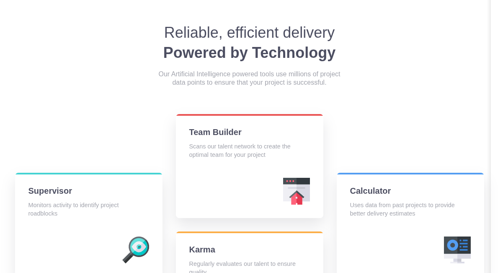

 <h1 align="center">

My solution to the [Four Card Feature Section](https://www.frontendmentor.io/challenges/four-card-feature-section-weK1eFYK) challenge.

</h1>

<div align="center">

## Preview



## Links

[View Live Project](https://yovanidosh.github.io/FmSoLuTiOns/challenges/four-card-feature-section-master/)

## Technologies Used

</div>

- HTML5
- CSS3
- CSS Custom Properties
- CSS Grid
- Flexbox
- BEM
- Media Queries
- Mobile-First Design
- SVG

<div align="center">

## Overview

</div>

The goal of this project was to build a feature section containing four cards and reproduce its responsive layout using semantic HTML and CSS.

The interface includes:

- A main heading and descriptive text.
- Decorative icons for each feature.
- Colored top borders for each card.
- A responsive layout for different screen sizes.
- An asymmetric desktop composition.

<div align="center">

## What I Learned

</div>

Throughout this project, I learned how to:

- Build layouts using **CSS Grid**.
- Position elements using `grid-column` and `grid-row`.
- Create an asymmetric composition without changing the HTML structure.
- Combine **CSS Grid and Flexbox** within the same interface.
- Use Grid to control the overall component layout.
- Use Flexbox to organize the content inside each card.
- Push elements toward the bottom of a container with `margin-top: auto`.
- Create decorative elements using pseudo-elements.
- Use `::before` to generate colored top borders for cards.
- Create component variations using BEM modifiers.
- Build a mobile-first layout and progressively adapt it to larger screens.
- Adjust the same HTML structure to different layouts based on viewport size.
- Limit content width using the CSS `min()` function.

<div align="center">

## Featured Code

</div>

### Asymmetric Layout with CSS Grid

One of the main challenges was positioning the four cards using explicit rows, columns, and named grid areas.

```css
@media (min-width: 64rem)
{
  .features
  {
    grid-template-columns: repeat(3, minmax(0, 1fr));
    grid-template-rows: repeat(4, 1fr);
    grid-template-areas:
      ". team ."
      "supervisor team calculator"
      "supervisor karma calculator"
      ". karma .";
    gap: 2rem;
  }
}
```

This creates the asymmetric desktop layout without changing the order of the elements or duplicating content in the HTML.

```text
             Team Builder

Supervisor                 Calculator

                 Karma
```

### Decorative Elements with Pseudo-Elements

The colored top borders are created using the `::before` pseudo-element.

```css
.feature-card::before
{
  content: "";
  position: absolute;
  top: 0;
  left: 0;
  width: 100%;
  height: 0.25rem;
}
```

Each BEM modifier defines its own color:

```css
.feature-card--supervisor::before
{
  background: var(--color-cyan);
}

.feature-card--team::before
{
  background: var(--color-red);
}

.feature-card--karma::before
{
  background: var(--color-orange);
}

.feature-card--calculator::before
{
  background: var(--color-blue);
}
```

This approach avoids adding HTML elements whose only purpose would be decorative.

### Combining CSS Grid and Flexbox

Each card uses Flexbox internally:

```css
.feature-card
{
  display: flex;
  flex-direction: column;
}
```

Meanwhile, the group of cards uses Grid:

```css
.features
{
  display: grid;
}
```

This helped me understand when to use each layout tool:

- **CSS Grid** controls the overall page structure and card placement.
- **Flexbox** distributes content within individual components.

### Positioning Icons with `margin-top: auto`

```css
.feature-card img
{
  width: 4rem;
  margin-top: auto;
  margin-left: auto;
}
```

Inside a Flexbox container with a column direction, `margin-top: auto` uses the available vertical space to push the icon toward the bottom of the card. The left auto margin aligns it to the right.

<div align="center">

## Accessibility

</div>

The project includes:

- Semantic HTML.
- A clear heading hierarchy.
- A labeled feature section using `aria-label`.
- Decorative icons with empty alternative text.
- `aria-hidden="true"` on decorative icons.
- A clear separation between meaningful content and purely visual elements.

The icons do not provide additional information, so they are excluded from screen reader announcements:

```html

```

<div align="center">

## Responsive Design

</div>

The project follows a **mobile-first approach**, progressively adapting the layout to larger screens.

### Mobile

The four cards are displayed vertically:

```text
Supervisor
    ↓
Team Builder
    ↓
Karma
    ↓
Calculator
```

This maintains a straightforward reading order on smaller screens.

### Tablet

The layout changes to two columns to make better use of the available space.

### Desktop

CSS Grid rearranges the cards into the asymmetric composition of the original design:


```text
             Team Builder

Supervisor                 Calculator

                 Karma
```

The side cards extend across two grid rows, positioning them alongside the two central cards.

<div align="center">

## Author

[Frontend Mentor](https://www.frontendmentor.io/profile/YovaniDosh)

[LinkedIn](https://www.linkedin.com/in/johanxt/)

</div>