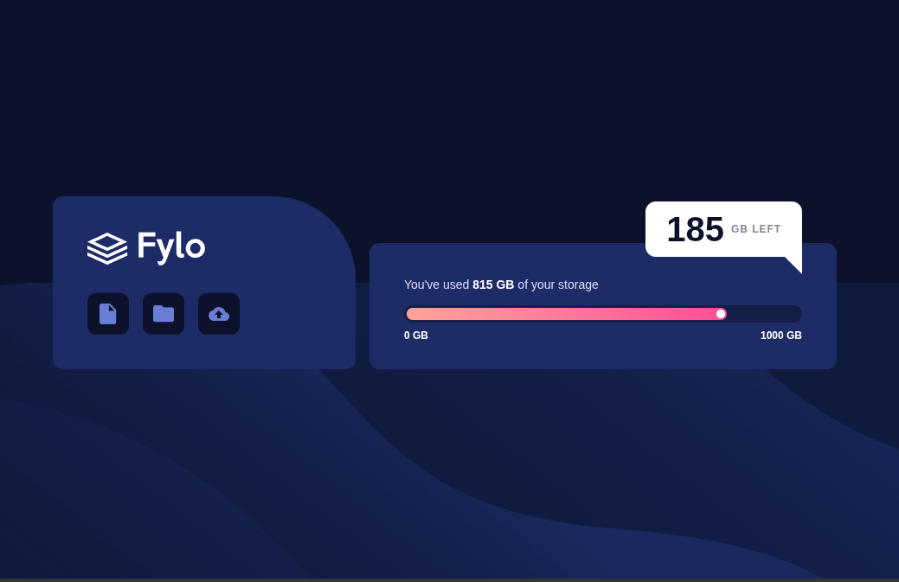

<h1 align="center">

This is my solution to the [Fylo Data Storage Component](https://www.frontendmentor.io/challenges/fylo-data-storage-component-1dZPRbV5n) challenge.

</h1>

<div align="center">

## Preview



</div>

<div align="center">

## Overview

</div>

The goal was to build a responsive storage component inspired by Fylo.

The component includes:

- Main panel with a logo.
- Document, folder, and upload buttons.
- Information about used storage.
- Progress bar.
- Visual indicator of storage usage.
- Remaining storage amount.
- Layout adapted for mobile and desktop.
- Hover and focus states.

<div align="center">

## Links

[View Live Project](https://yovanidosh.github.io/FmSoLuTiOns/challenges/fylo-data-storage-component-master/)

## Technologies Used

</div>

- Semantic HTML
- Sass
- CSS Custom Properties
- CSS Gradients
- Flexbox
- CSS Grid
- Responsive design
- Mobile-first design
- BEM methodology
- Media queries
- npm

<div align="center">

## What I Learned

</div>

In this project, I learned how to:

- Initialize a project using `npm`.
- Understand the purpose of `package.json`.
- Understand the purpose of `package-lock.json`.
- Install dependencies using npm.
- Install Sass as a development dependency.
- Compile `.scss` files into `.css`.
- Automate compilation using `sass --watch`.
- Create Sass variables using `$`.
- Separate styles using partials.
- Import Sass modules using `@use`.
- Use nesting to organize selectors.
- Use `&` to reference the parent selector.
- Create an accessible progress bar.
- Use `role="progressbar"` and `aria-*` attributes.
- Create CSS gradients.
- Create triangles using borders.
- Use pseudo-elements with `::after`.
- Adapt element positioning between mobile and desktop layouts.
- Understand Bootstrap utility classes.
- Evaluate when a dependency actually adds value to a project.

<div align="center">

## Featured Code

</div>

### Sass Nesting

```scss
.storage {
  &__button {
    background: $color-very-dark-blue;

    &:hover {
      transform: translateY(-0.2rem);
    }

    &:focus-visible {
      outline: 0.15rem solid $color-pale-blue;
    }
  }
}
```

Sass transforms this structure into conventional CSS selectors.

### Progress Bar

```scss
&__progress-value {
  width: 81.5%;
  height: 100%;

  background: linear-gradient(
    to right,
    $gradient-start,
    $gradient-end
  );
}
```

The `81.5%` value visually represents the `815 GB` used out of a total capacity of `1000 GB`.

### CSS Triangle

```scss
&::after {
  content: "";

  position: absolute;
  right: 0;
  bottom: -1.25rem;

  border-top: 1.25rem solid white;
  border-left: 1.25rem solid transparent;
}
```

This technique creates the small triangle on the indicator without using an image.

<div align="center">

## Accessibility

</div>

The project includes:

- Semantic HTML.
- Alternative text.
- Decorative icons marked with `aria-hidden`.
- Buttons with accessible names.
- `:focus-visible` states.
- A progress bar using `role="progressbar"`.
- `aria-valuemin`.
- `aria-valuemax`.
- `aria-valuenow`.

<div align="center">

## Responsive Design

</div>

The project was built following a mobile-first strategy.

On mobile devices, the panels are arranged vertically.

On larger screens, the layout changes to two columns, and the remaining storage indicator changes position to reproduce the desktop design.

<div align="center">

## Author

[Frontend Mentor](https://www.frontendmentor.io/profile/YovaniDosh)

[LinkedIn](https://www.linkedin.com/in/johanxt/)

</div>