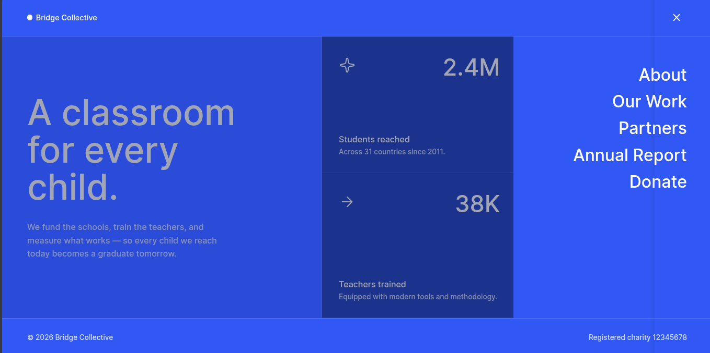

<h1 align="center">

My Solution to the [Grid Landing Page](https://www.frontendmentor.io/challenges/grid-landing-page) challenge.

</h1>

## Preview



## Overview

The goal was to build a responsive social impact landing page featuring statistics and an interactive menu.

The project includes:

- Main hero section.
- Four statistics.
- Responsive menu.
- Overlay when opening the navigation.
- Custom icons for opening and closing the menu.
- Mobile-first design.

<div align="center">

## Links

[View Live Project](https://yovanidosh.github.io/FmSoLuTiOns/challenges/grid-landing-page-main/)

</div>

## What I Learned

In this project, I learned how to:

- Control visual states using JavaScript.
- Change icons dynamically.
- Update `aria-expanded`.
- Close menus using the `Escape` key.
- Create interactive overlays.
- Combine CSS Grid and Flexbox.
- Build different layouts for mobile and desktop.
- Organize responsive statistics.
- Maintain a mobile-first strategy.

## Featured Code

```js
function updateMenuState(isOpen)
{
  document.body.classList.toggle("menu-open", isOpen);

  menuButton.setAttribute("aria-expanded", String(isOpen));
  menuButton.setAttribute(
    "aria-label",
    isOpen ? "Close navigation" : "Open navigation"
  );

  menuIcon.src = isOpen ? CLOSE_ICON : MENU_ICON;
}
```

This function centralizes the menu state and keeps CSS, accessibility, and icons synchronized.

## Accessibility

The project includes:

- Semantic HTML.
- Accessible menu button.
- `aria-expanded`.
- `aria-controls`.
- `aria-label`.
- Keyboard support for closing the menu with `Escape`.

## Responsive Design

On mobile, the content is stacked vertically.

On desktop, the interface changes to a two-column layout, with statistics arranged using Grid and a side panel for navigation.

## Technologies Used

- HTML5
- CSS3
- JavaScript
- CSS Grid
- Flexbox
- CSS Custom Properties
- Media Queries
- Mobile-first


<div align="center">

## Author

[Frontend Mentor](https://www.frontendmentor.io/profile/YovaniDosh)

[LinkedIn](https://www.linkedin.com/in/johanxt/)

</div>