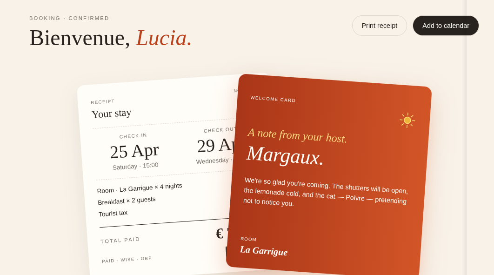

# <h1 align="center">My Solution to the [Hotel Booking Confirmation Page](https://www.frontendmentor.io/challenges/hotel-booking-confirmation-page) challenge.</h1>

## <h2 align="center">Preview</h2>



## <h2 align="center">Overview</h2>

The goal of this challenge was to build a responsive booking confirmation dashboard for Maison Soleil, combining a clear information hierarchy with an elegant hospitality-inspired interface.

The interface includes:

- Responsive sidebar and mobile navigation.
- Booking confirmation header and receipt.
- Welcome card with an interactive card-fanning effect.
- Arrival instructions and breakfast information.
- WiFi credentials with a copy-to-clipboard feature.
- Interactive states for hover, focus, and active elements.
- Accessible feedback for clipboard operations.
- Keyboard support for closing the mobile navigation.

## <div align="center">Links</div>

<div align="center">

[View Live Project](https://yovanidosh.github.io/FmSoLuTiOns/challenges/hotel-booking-confirmation-page-main/)

</div>

## <h2 align="center">What I Learned</h2>

Through this project, I learned how to:

- Build a responsive dashboard using a mobile-first approach.
- Transform a desktop sidebar into a mobile navigation menu.
- Manage navigation state with JavaScript and synchronize it with `aria-expanded`.
- Improve keyboard navigation by handling the Escape key and restoring focus.
- Build complex layouts with CSS Grid and Flexbox.
- Use `position: sticky`, `transform`, and `z-index` to create layered card layouts.
- Use the `:has()` pseudo-class to respond to the interaction state of descendant elements.
- Create transitions while respecting `prefers-reduced-motion`.
- Structure related information with semantic HTML elements such as `<dl>`, `<dt>`, and `<dd>`.
- Use the Clipboard API with asynchronous functions and `try...catch` error handling.
- Provide visual and screen-reader feedback for dynamic interactions.
- Implement a manual recovery option when clipboard access fails.
- Use visually hidden content and ARIA attributes to improve accessibility.
- Apply BEM naming conventions to keep styles organized and maintainable.
- Separate responsibilities between HTML, CSS, and JavaScript.

## <h2 align="center">Featured Code</h2>

### Interactive Card-Fanning Effect

```css
.booking:has(.booking__fan-trigger:hover) .receipt,
.booking:has(.booking__fan-trigger:focus-visible) .receipt
{
  transform-origin:-1rem right;
  transform:translateX(-5.5rem) rotate(8deg)
}

.booking:has(.booking__fan-trigger:hover) .welcome-card,
.booking:has(.booking__fan-trigger:focus-visible) .welcome-card
{
  transform-origin:1rem left;
  transform:translateX(5.5rem) rotate(-5deg)
}
```

The `:has()` pseudo-class allows the booking container to respond to hover and keyboard focus on the interaction button, creating a layered card-fanning effect without requiring JavaScript for the visual transition.

### Clipboard API and Error Handling

```javascript
async function copyWifiPassword()
{
  const password = wifiPassword.textContent.trim();

  try
  {
    if (!navigator.clipboard || !window.isSecureContext)
    {
      throw new Error("Clipboard API is unavailable.");
    }

    await navigator.clipboard.writeText(password);

    copyPasswordButton.textContent = "Copied!";
    copyStatus.textContent = "WiFi password copied to clipboard.";
  }
  catch (error)
  {
    console.error("Unable to copy WiFi password:", error);

    selectWifiPassword();

    copyPasswordButton.textContent = "Try again";
    copyStatus.textContent =
      "Automatic copying failed. The password has been selected. Copy it manually using your device's copy command.";
  }
}
```

This implementation uses asynchronous clipboard access, handles failures, and provides a manual recovery option when automatic copying is unavailable.

### Accessible Mobile Navigation

```javascript
function handleMenuKeydown(event)
{
  if (event.key !== "Escape")
  {
    return;
  }

  if (!sidebar.classList.contains("sidebar--open"))
  {
    return;
  }

  event.preventDefault();
  closeMobileMenu({ restoreFocus: true });
}
```

The Escape key closes the open mobile navigation and restores keyboard focus to the menu button, making the interaction easier to use without a mouse.

## <h2 align="center">Accessibility</h2>

The project incorporates several accessibility practices:

- Semantic HTML landmarks and structural elements.
- Descriptive accessible names for interactive controls.
- `aria-expanded` and `aria-controls` to communicate mobile navigation state.
- `aria-current` to identify the active navigation link.
- `aria-live` and `role="status"` for clipboard feedback.
- Visually hidden headings and status messages.
- Decorative icons hidden from assistive technologies.
- Visible keyboard focus indicators using `:focus-visible`.
- Keyboard support for closing the mobile menu with Escape.
- Focus restoration when the mobile menu is closed with Escape.
- Reduced-motion support through `prefers-reduced-motion`.

## <h2 align="center">Responsive Design</h2>

The dashboard follows a mobile-first approach, adapting its layout to different viewport sizes.

**On mobile devices:**

- The sidebar becomes a compact top navigation bar.
- Navigation links are revealed through a toggle button.
- The welcome card appears before the receipt.
- Information cards are stacked vertically.
- Layout spacing adapts to narrower screens.

**On desktop screens:**

- The sidebar remains visible and sticky.
- The receipt and welcome card form a layered composition.
- Hovering over or focusing the card interaction button separates the cards.
- Arrival, WiFi, and breakfast information appear in three columns.

## <h2 align="center">Technologies Used</h2>

- HTML5
- CSS3
- JavaScript (ES6+)
- CSS Grid
- Flexbox
- CSS Media Queries
- CSS Transforms and Transitions
- CSS `:has()` pseudo-class
- Clipboard API
- ARIA attributes
- Responsive Web Design

<div align="center">

## Author

[Frontend Mentor](https://www.frontendmentor.io/profile/YovaniDosh)

[LinkedIn](https://www.linkedin.com/in/johanxt/)

</div>