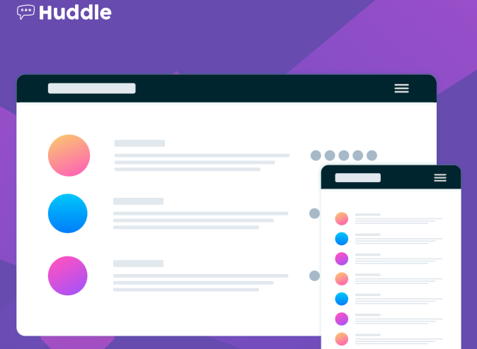

 <h1 align="center">

My solution to the [Huddle Landing Page with Single Introductory Section](https://www.frontendmentor.io/challenges/huddle-landing-page-with-single-introductory-section-B_2Wvxgi0) challenge.

</h1>

<div align="center">

## Preview



## Links

[View Live Project](https://yovanidosh.github.io/FmSoLuTiOns/challenges/huddle-landing-page-with-single-introductory-section-master/)

## Technologies Used

</div>

- HTML5
- CSS3
- CSS Grid
- Flexbox
- CSS Custom Properties
- Media Queries
- BEM
- Mobile-first

<div align="center">

## Overview

</div>

The goal of this project was to build a responsive landing page for Huddle.

The page includes:

- Huddle logo.
- Main illustration.
- Registration button.
- Social media links.
- Interactive states.
- Mobile-first design.

<div align="center">

## What I Learned

</div>

Throughout this project, I learned how to:

- Build a responsive hero section.
- Change background images using media queries.
- Create single-column and two-column layouts.
- Use `minmax()` with CSS Grid.
- Create pill-shaped buttons.
- Apply `:hover` and `:focus-visible` states.
- Create circular social media links.
- Use `clamp()` for responsive typography.
- Implement `prefers-reduced-motion`.
- Maintain a mobile-first approach.

<div align="center">

## Featured Code

</div>

### Responsive Hero Layout

```css
.hero 
{
  display: grid;
  gap: 4rem;
}

@media (min-width: 64rem) 
{
  .hero 
  {
    grid-template-columns:
    minmax(0, 1.25fr)
    minmax(20rem, 0.75fr);
    align-items: center;
  }
}
```

This layout transforms the hero section from a single column on mobile devices into a two-column layout on desktop screens.

<div align="center">

## Accessibility

</div>

The project includes:

- Semantic HTML.
- Alternative text for images.
- Accessible social media links.
- `aria-label` attributes.
- `:focus-visible` states.
- Support for `prefers-reduced-motion`.

<div align="center">

## Responsive Design

</div>

The project follows a mobile-first approach.

On mobile devices, the content is arranged vertically. On desktop screens, the hero section transforms into a two-column layout.

<div align="center">

## Author

[Frontend Mentor](https://www.frontendmentor.io/profile/YovaniDosh)

[LinkedIn](https://www.linkedin.com/in/johanxt/)

</div>