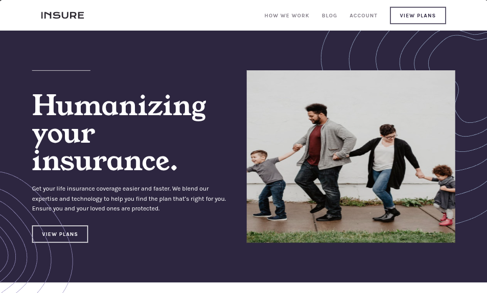

<div align="center">

<h1 align="center">
  My Solution to the <a href="https://www.frontendmentor.io/challenges/insure-landing-page-uTU68JV8">Insure Landing Page</a> Challenge
</h1>

## Preview



## Links

[View Live Project](https://yovanidosh.github.io/FmSoLuTiOns/challenges/insure-landing-page-master/)

## Technologies Used

</div>

- Semantic HTML5
- Sass (SCSS)
- CSS3
- JavaScript
- CSS Grid
- Flexbox
- CSS Pseudo-elements
- Responsive Images with `<picture>`
- Local Fonts with `@font-face`
- Accessibility with ARIA
- Mobile-First Design

<div align="center">

## Overview

</div>

The goal was to build a responsive landing page for an insurance company, combining accessible navigation with an editorial layout adapted to different screen sizes.

The interface includes:

- Responsive main navigation.
- A mobile menu controlled by JavaScript.
- A hero section with a responsive image and call to action.
- Decorative patterns positioned using pseudo-elements.
- A benefits section arranged with CSS Grid.
- A featured card explaining how the service works.
- Social media links with accessible names.
- A responsive footer with multiple link groups.
- A mobile-first layout.

<div align="center">

## What I Learned

</div>

Through this project, I learned how to:

- Control a mobile menu using `aria-expanded`.
- Prevent hidden navigation from receiving keyboard focus using `inert`.
- Update the menu icon and the toggle button's accessible name according to its state.
- Use `<picture>` to load different images for mobile and desktop screens.
- Overlay an image on the hero section without duplicating content.
- Position decorative patterns outside their containers using pseudo-elements.
- Create responsive layouts with CSS Grid and Flexbox.
- Organize styles and variants using Sass nesting.
- Load local fonts using `@font-face`.

<div align="center">

## Featured Code

</div>

### Accessible Mobile Navigation

```javascript
function setMenu(open) {
  menuToggle.setAttribute("aria-expanded", String(open));
  menu.toggleAttribute("inert", !open && !desktopMedia.matches);
  document.body.classList.toggle("menu-open", open);

  menuIcon.src = open
    ? "../../assets/images/insure-icon-close.svg"
    : "../../assets/images/insure-icon-hamburger.svg";

  menuLabel.textContent = open ? "Close menu" : "Open menu";
}
```

The `aria-expanded` attribute communicates whether the menu is open, while `inert` prevents hidden navigation links from receiving keyboard focus. The function also updates the icon, accessible label, and body class to keep the interface synchronized with the menu state.

<div align="center">

## Accessibility

</div>

The project includes:

- Semantic HTML.
- A clear heading hierarchy.
- A native button to control the mobile menu.
- `aria-expanded` to communicate the navigation state.
- `inert` to prevent access to hidden navigation links.
- Visible keyboard focus states.
- Meaningful alternative text for informative images.
- Empty alternative text for decorative images.
- Accessible names for social media links.
- Support for `prefers-reduced-motion`.

<div align="center">

## Responsive Design

</div>

The project follows a mobile-first approach.

**On mobile devices:**

- Navigation appears in a vertical dropdown panel.
- The main image appears before the hero content.
- Sections are arranged in a single column.
- Decorative patterns complement the content without adding unnecessary HTML elements.
- Footer links are arranged vertically.

**On tablet screens:**

- The benefits grid expands to two columns.
- Footer link groups make better use of horizontal space.

**On desktop screens:**

- Navigation switches to a horizontal layout.
- The image is positioned over the hero section.
- Decorative patterns overlap the main composition.
- Benefits are arranged in three columns.
- The call-to-action section uses a horizontal layout.
- Footer links are organized into four columns.

<div align="center">

## Author

[Frontend Mentor](https://www.frontendmentor.io/profile/YovaniDosh)

[LinkedIn](https://www.linkedin.com/in/johanxt/)

</div>