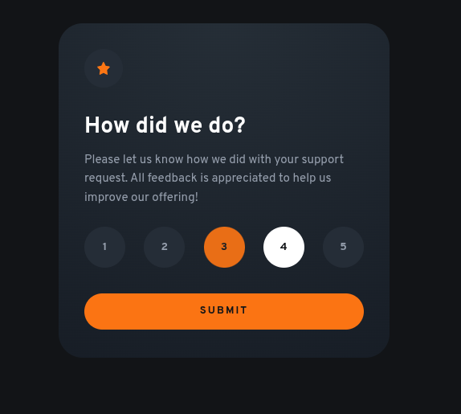

<h1 align="center">

This is my solution to the [Interactive Rating Component](https://www.frontendmentor.io/challenges/interactive-rating-component-koxpeBUmI) challenge.

</h1>

<div align="center">

## Preview



</div>

<div align="center">

## Overview

</div>

The goal was to build a responsive rating card that allows users to select a score and display a personalized confirmation.

The interface includes:

- Five rating options.
- Single selection using native form controls.
- Validation before submitting the rating.
- A thank-you state displaying the selected score.
- Responsive layout for mobile and desktop devices.

<div align="center">

## Links

[View Live Project](https://yovanidosh.github.io/FmSoLuTiOns/challenges/interactive-rating-component-main/)

## Technologies Used

</div>

- HTML5
- CSS3
- JavaScript
- Flexbox
- Media queries
- Local variable font
- SVG
- Responsive design

<div align="center">

## What I Learned

</div>

In this project, I learned how to:

- Group related options using `fieldset` and `legend`.
- Customize radio buttons without losing their native functionality.
- Retrieve the selected value from `form.elements`.
- Switch between two interface states using the `hidden` attribute.
- Display dynamic data using the `output` element.
- Create accessible `:hover`, `:checked`, and `:focus-visible` states.
- Respect reduced-motion preferences.
- Load a local variable font using `@font-face`.

<div align="center">

## Featured Code

</div>

### Rating Submission

```javascript
ratingForm.addEventListener('submit', (event) => {
  event.preventDefault();

  const selectedRating = ratingForm.elements.rating.value;

  if (!selectedRating) {
    return;
  }

  ratingOutput.value = selectedRating;
  ratingCard.hidden = true;
  thankYouCard.hidden = false;
});
```

The form uses the single-selection behavior of radio buttons. When submitted, JavaScript retrieves the selected value and displays the final message.

<div align="center">

## Accessibility

</div>

The project includes:

- Semantic HTML with identifiable forms and sections.
- Options grouped using `fieldset` and `legend`.
- Keyboard-operable controls.
- Native validation using `required`.
- Visible focus states.
- Decorative images with empty alternative text.
- Dynamic results represented using `output`.

<div align="center">

## Responsive Design

</div>

On mobile devices:

- The card uses the available width with compact spacing.
- The rating options are distributed evenly.
- The content remains readable from widths of 320px upward.

On desktop screens:

- The card remains centered and maintains a maximum width.
- Internal spacing, controls, and typography increase.
- Both interface states maintain consistent visual dimensions.

<div align="center">

## Author

[Frontend Mentor](https://www.frontendmentor.io/profile/YovaniDosh)

[LinkedIn](https://www.linkedin.com/in/johanxt/)

</div>