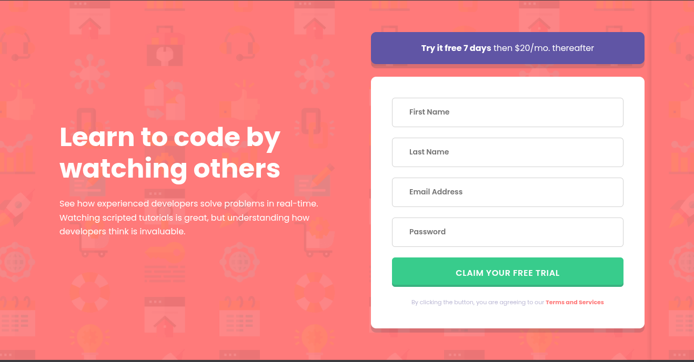

 <h1 align="center">

This is my solution to the [Intro Component With Sign Up Form](https://www.frontendmentor.io/challenges/intro-component-with-signup-form-5ce5d66f634b3500d9b2a9c5) challenge.

</h1>

<div align="center">

## Preview



</div>

<div align="center">

## Overview

</div>

The goal was to build a responsive introduction section with a sign-up form and accessible client-side validation.

The interface includes:

- Introduction to the learning service.
- Free trial offer.
- Sign-up form with four fields.
- Specific error messages for empty fields.
- Email format validation.
- Support for names containing internal spaces.
- Success feedback after valid submission.
- Responsive layout adapted to mobile and desktop screens.

<div align="center">

## Links

[View Live Project](https://yovanidosh.github.io/FmSoLuTiOns/challenges/intro-component-with-signup-form-master/)

## Technologies Used

</div>

- Semantic HTML
- CSS Custom Properties
- CSS Grid
- Responsive design
- Mobile-first design
- BEM methodology
- Media queries
- Poppins Variable Font
- JavaScript
- HTML Constraint Validation API
- Accessibility attributes
- npm
- Playwright
- Automated testing

<div align="center">

## What I Learned

</div>

In this project, I learned how to:

- Use `validity.valueMissing` and `validity.typeMismatch` to validate form fields.
- Generate specific error messages based on validation results.
- Validate names containing spaces without accepting whitespace-only values.
- Synchronize visual error states with `aria-invalid`.
- Communicate dynamic feedback using `aria-live`.
- Move focus to the first invalid field after submission.
- Use `toggleAttribute()` to manage boolean HTML attributes.
- Build a responsive, mobile-first layout with CSS Grid.
- Implement `hover`, `active`, and `focus-visible` states.
- Load a local Poppins Variable Font using `@font-face`.
- Respect the `prefers-reduced-motion` user preference.
- Configure npm scripts and development dependencies.
- Write automated browser tests using Playwright.
- Verify form validation, error recovery, and successful submission through automated tests.

<div align="center">

## Featured Code

</div>

### Reusable Field Validation

```javascript
function updateField(field)
{
  const fieldContainer =
    field.input.closest(".signup-form__field");

  const errorMessage =
    fieldContainer.querySelector(".signup-form__error");

  const message = getErrorMessage(field);
  const hasError = message !== "";

  fieldContainer.classList.toggle("has-error", hasError);

  if (hasError)
  {
    field.input.setAttribute("aria-invalid", "true");
  }
  else
  {
    field.input.removeAttribute("aria-invalid");
  }

  errorMessage.textContent = message;

  return !hasError;
}
```

This function centralizes the validation feedback for each field. It updates the visual error state, communicates the validation status to assistive technologies, and displays the corresponding error message without duplicating the same logic for every input.

### Form Submission and Validation

```javascript
form.addEventListener("submit", (event) =>
{
  event.preventDefault();

  const fieldsAreValid =
    fields.map(updateField).every(Boolean);

  if (!fieldsAreValid)
  {
    fields.find((field) =>
      field.input.hasAttribute("aria-invalid")
    ).input.focus();

    return;
  }

  feedback.textContent =
    "Demo completed successfully. No account was created!";

  form.reset();
});
```

The form validates every field before displaying the success message. If validation fails, focus moves to the first invalid field. If all fields are valid, the form displays feedback and resets its inputs.

The success message is for demonstration purposes only; no account is created or stored.

<div align="center">

## Accessibility

</div>

The project includes:

- Semantic HTML.
- Labels associated with all form fields.
- Dynamic error messages using `aria-live`.
- Invalid field states communicated through `aria-invalid`.
- Automatic focus on the first invalid field.
- Accessible names for form controls.
- Visible keyboard focus states.
- Decorative icons hidden from assistive technologies with `aria-hidden`.
- Support for the `prefers-reduced-motion` preference.

<div align="center">

## Responsive Design

</div>

The project follows a mobile-first approach.

On mobile devices:

- The introduction and form are arranged in a single column.
- Text content is centered.
- Form controls occupy the available width.

On desktop screens:

- The layout changes to a two-column grid.
- The introduction is aligned to the left.
- The offer and sign-up form share the second column.
- The background adapts to the desktop layout.

<div align="center">

## Author

[Frontend Mentor](https://www.frontendmentor.io/profile/YovaniDosh)

[LinkedIn](https://www.linkedin.com/in/johanxt/)

</div>