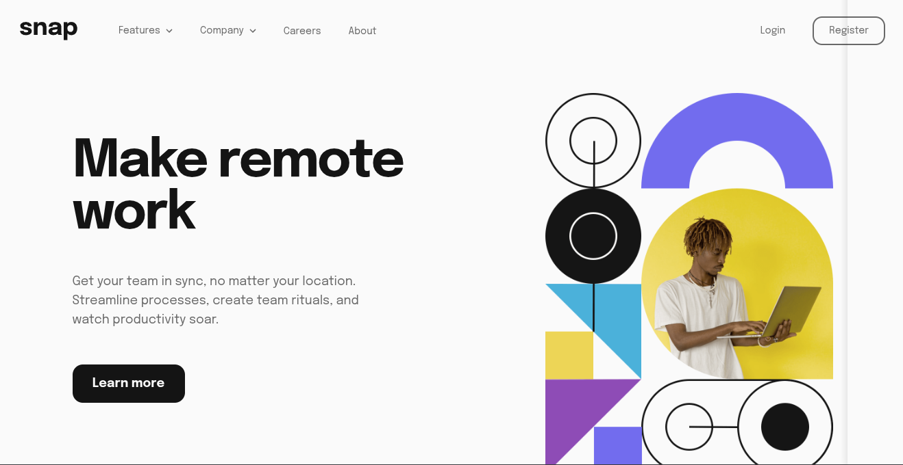

 <h1 align="center">

My Solution to the [Intro Section with Dropdown Navigation](https://www.frontendmentor.io/challenges/intro-section-with-dropdown-navigation-ryaPetHE5) challenge.

</h1>

## Preview



## Overview

The goal was to build a responsive landing page featuring dropdown navigation, a mobile slide-in menu, and adaptive hero imagery.

The project includes:

- Main hero section.
- Two dropdown menus: Features and Company.
- Mobile slide-in navigation panel.
- Overlay when opening the mobile menu.
- Login and registration links.
- Responsive hero images.
- Client logos.
- Interactive dropdown icons.
- Mobile-first responsive design.

<div align="center">

## Links

[View Live Project](https://yovanidosh.github.io/FmSoLuTiOns/challenges/intro-section-with-dropdown-navigation-main/)

</div>

## What I Learned

In this project, I learned how to:

- Control dropdown states using JavaScript.
- Keep dropdown visibility and arrow icons synchronized.
- Update `aria-expanded` and use `aria-controls`.
- Ensure only one dropdown is open at a time.
- Close dropdowns when clicking outside or pressing the `Escape` key.
- Manage keyboard focus within a mobile navigation panel.
- Restore focus when closing the menu.
- Use the `<picture>` element for responsive images.
- Combine CSS Grid and Flexbox.
- Respect reduced-motion preferences.

## Featured Code

```js
function setDropdownState(button, isOpen) {
  const menuId = button.getAttribute('aria-controls');
  const menu = document.getElementById(menuId);
  const arrow = button.querySelector('.dropdown__arrow');

  button.setAttribute('aria-expanded', String(isOpen));
  menu.hidden = !isOpen;
  arrow.src = isOpen
    ? '../../assets/images/icon-arrow-up.svg'
    : '../../assets/images/icon-arrow-down.svg';
}
```

This function centralizes each dropdown's state, keeping its visibility, accessibility attributes, and arrow icon synchronized.

## Accessibility

The project includes:

- Semantic HTML.
- Native buttons for interactive navigation controls.
- `aria-expanded`.
- `aria-controls`.
- Keyboard support for closing menus with `Escape`.
- Focus management and restoration.
- Focus trapping within the mobile navigation.
- Visible keyboard focus indicators.
- Alternative text for meaningful images.
- Support for `prefers-reduced-motion`.

## Responsive Design

On mobile, the hero content is stacked vertically, and navigation opens in a slide-in panel with an overlay.

On desktop, the navigation remains visible in the header, dropdowns appear as floating panels, and the hero uses a two-column layout with client logos arranged along the bottom.

## Technologies Used

- HTML5
- CSS3
- JavaScript
- CSS Grid
- Flexbox
- CSS Custom Properties
- Media Queries
- Epilogue Variable Font
- Mobile-first responsive design

<div align="center">

## Author

[Frontend Mentor](https://www.frontendmentor.io/profile/YovaniDosh)

[LinkedIn](https://www.linkedin.com/in/johanxt/)

</div>
