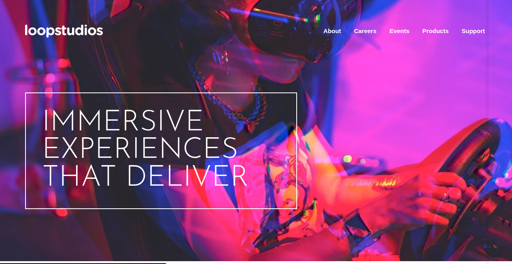

<h1 align="center">

My Solution for [Loopstudios Landing Page](https://www.frontendmentor.io/challenges/loopstudios-landing-page-N88J5Onjw) challenge.

</h1>

## <div align="center">Preview</div>



## <div align="center">Links</div>

<div align="center">

[View Live Project](https://yovanidosh.github.io/FmSoLuTiOns/challenges/hotel-booking-confirmation-page-main/)

</div>

## <div align="center">Overview</div>

The goal of this project was to build a responsive landing page showcasing immersive virtual reality experiences and a gallery of creative projects.

The interface includes:

- A hero section with a main heading and primary navigation.
- A full-screen mobile navigation menu.
- A company introduction section.
- A responsive gallery featuring eight creative projects.
- Social media links and secondary navigation.

## <div align="center">Technologies Used</div>

- HTML5
- CSS3
- Sass
- JavaScript
- CSS Grid
- Flexbox
- Responsive images
- Semantic HTML
- Web accessibility best practices

## <div align="center">What I Learned</div>

- Building responsive galleries with different layouts for mobile and desktop.
- Using the `<picture>` element to deliver viewport-specific images.
- Layering text over images with gradients and CSS positioning.
- Organizing colors, typography, and breakpoints with Sass variables.
- Implementing interactive states for pointer and keyboard users.
- Managing mobile navigation with JavaScript and accessibility attributes.

## <div align="center">Featured Code</div>

```scss
.creations__grid
{
  display: grid;
  grid-template-columns: repeat(4, minmax(0, 1fr));
  gap: 1.9rem;
}
```

On desktop, the creations gallery uses four flexible columns. The `minmax(0, 1fr)` function allows each column to shrink within the available space, helping prevent content from forcing the grid beyond its container.

## <div align="center">Accessibility</div>

- Semantic HTML elements for a meaningful document structure.
- Accessible names for navigation landmarks and interactive controls.
- A native button connected to the navigation menu through `aria-controls`.
- The `aria-expanded` attribute to communicate the mobile menu state.
- The `inert` attribute to prevent interaction with hidden navigation links.
- Menu dismissal through navigation links and the `Escape` key.
- Focus restoration when the menu is dismissed using the keyboard.
- Visible interaction states with `:hover` and `:focus-visible`.
- Support for the `prefers-reduced-motion` media query.

## <div align="center">Responsive Design</div>

The layout adapts to different screen sizes using responsive images, CSS Grid, Flexbox, and media queries.

On mobile, the navigation menu covers the viewport, the content is stacked vertically, and the creation cards use horizontal images. On desktop, the navigation remains visible, the company introduction overlays its image, and the gallery displays four columns with vertical image compositions.

<div align="center">

## Author

[Frontend Mentor](https://www.frontendmentor.io/profile/YovaniDosh)

[LinkedIn](https://www.linkedin.com/in/johanxt/)

</div>