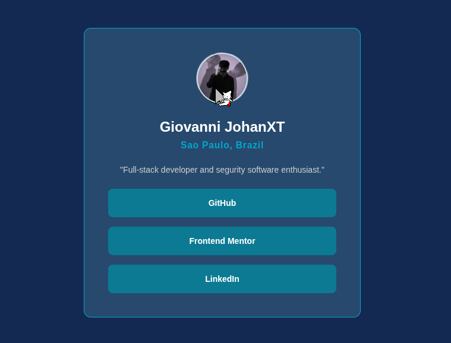

<h1 align="center">

My [Social Links ](https://www.frontendmentor.io/challenges/social-links-profile-UG32l9m6dQ) Profile.

</h1>

<div align="center">

## Preview



</div>

<div align="center">

## Overview

</div>

The goal was to build a responsive social profile card.

The interface includes:

- User avatar.
- Name.
- Location.
- Personal description.
- Social media links.
- Hover, focus, and active states.
- Centered responsive layout.

<div align="center">

## Links

[View Live Project](https://yovanidosh.github.io/FmSoLuTiOns/challenges/my-social-link/)

## Technologies Used

</div>

- Semantic HTML
- CSS Grid
- Flexbox
- BEM methodology
- Mobile-first design
- Responsive design

<div align="center">

## Featured Code

</div>

### Hover Animation

```css
.profile-card__avatar:hover
{
  transform: rotate(10deg);
}
```
With this, we make the avatar turn to the right.

### Responsive Card

```less
.profile-card {
  width: min(100%, 24rem);
}
```

Thanks to `min()`, the card adapts to small screens without growing excessively on larger screens.

<div align="center">

## Accessibility

</div>

The project includes:

- Semantic HTML.
- Keyboard navigation.
- Links implemented with `<a>`.
- `:focus-visible` states.
- Alternative text for the avatar.
- Contrast between text and background.
- Visible interactive states.

<div align="center">

## Responsive Design

</div>

The project was built following a mobile-first strategy.

The card uses a flexible width with a maximum limit, allowing it to maintain virtually the same structure across mobile devices and desktop screens.

This made it possible to avoid unnecessary media queries.

<div align="center">

## Author

[Frontend Mentor](https://www.frontendmentor.io/profile/YovaniDosh)

[LinkedIn](https://www.linkedin.com/in/johanxt/)

</div>