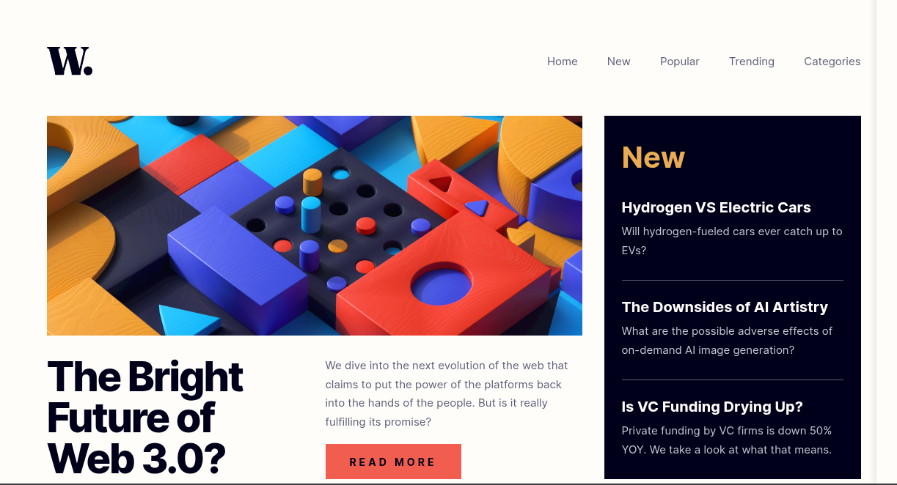

<h1 align="center">

My Solution for [News Homepage](https://www.frontendmentor.io/challenges/news-homepage-H6SWTa1MFl)

</h1>

## <div align="center">Preview</div>



## <div align="center">Links</div>

<div align="center">

[View Live Project](https://yovanidosh.github.io/FmSoLuTiOns/challenges/news-homepage-main/)

</div>

## <div align="center">Overview</div>

The goal of this project was to build a responsive news homepage featuring a lead story, recent news, popular articles, and adaptive navigation.

The interface includes:

- A header with primary navigation.
- A mobile slide-out navigation menu.
- A responsive lead story image using the `<picture>` element.
- A section featuring the latest news.
- A numbered list of popular articles.
- A Mobile First layout reorganized with CSS Grid and Flexbox.

## <div align="center">Technologies Used</div>

- HTML5
- Sass
- CSS3
- JavaScript
- CSS Grid
- Flexbox
- Local variable font
- npm

## <div align="center">What I Learned</div>

Throughout this project, I learned how to:

- Build an editorial-style homepage using semantic HTML.
- Serve different images based on the viewport using `<picture>` and `<source>`.
- Reorganize content with CSS Grid while preserving its semantic order.
- Create an accessible mobile navigation menu.
- Manage keyboard focus while the navigation is open.
- Close the menu using a button, the overlay, a navigation link, or the `Escape` key.
- Use Sass variables and nesting without introducing unnecessary abstractions.
- Compile Sass into CSS suitable for deployment with GitHub Pages.

## <div align="center">Featured Code</div>

### Accessible Navigation State

```javascript
function setMenuState(isOpen, { restoreFocus = true } = {})
{
  document.body.classList.toggle("menu-open", isOpen);
  menuButton.setAttribute("aria-expanded", String(isOpen));

  navigation.inert = !isOpen && !desktopMediaQuery.matches;

  const menuLabel = isOpen ? "Close navigation" : "Open navigation";

  menuButton.setAttribute("aria-label", menuLabel);
  menuButton.querySelector(".visually-hidden").textContent = menuLabel;

  if (isOpen) {
    closeButton.focus();
  } else if (restoreFocus && !desktopMediaQuery.matches) {
    menuButton.focus();
  }
}
```

The menu state is managed centrally through a single function. The `menu-open` class controls the visual presentation, while `aria-expanded` communicates the current state to assistive technologies. The `inert` attribute prevents interaction with hidden navigation links, and focus is managed according to the menu state and viewport.

## <div align="center">Accessibility</div>

The project includes:

- Semantic HTML landmarks and elements.
- A clear heading hierarchy.
- Native buttons to open and close the mobile navigation.
- The `aria-expanded` attribute to communicate the menu state.
- Accessible names for icon-based controls.
- Descriptive alternative text for informative images.
- Keyboard navigation and dismissal using the `Escape` key.
- Visible focus indicators with `:focus-visible`.
- Reduced-motion support through `prefers-reduced-motion`.
- Focus management for the mobile navigation menu.

## <div align="center">Responsive Design</div>

On mobile devices:

- Content is displayed in a single column.
- Navigation opens in a side panel.
- A dark overlay separates the menu from the page content.
- The lead story uses a mobile-specific image.

On desktop:

- Navigation remains visible in the header.
- The lead story spans two columns.
- The latest news section occupies the third column.
- Popular articles are displayed in a three-column row.

## <div align="center">Compilation</div>

The Sass source file is located at `scss/style.scss`. To compile it into the CSS file used by the browser, run the following command from the project root:

```bash
npx sass challenges/news-homepage-main/scss/style.scss challenges/news-homepage-main/css/style.css --style=expanded
```

## <div align="center">Author</div>

<div align="center">

[Frontend Mentor](https://www.frontendmentor.io/profile/YovaniDosh)

[LinkedIn](https://www.linkedin.com/in/johanxt/)

</div>
