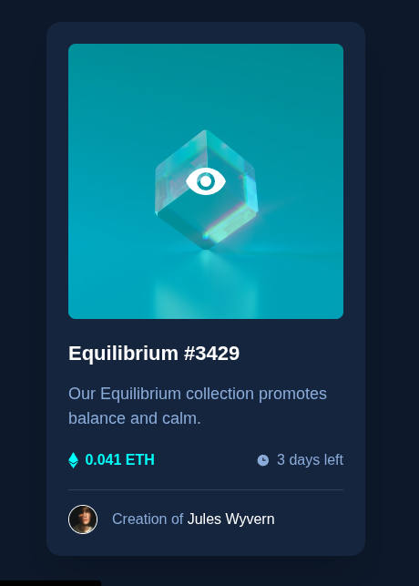

 <h1 align="center">

This is my solution to the [NFT Preview Card Component](https://www.frontendmentor.io/challenges/nft-preview-card-component-SbdUL_w0U) challenge.

</h1>

<div align="center">

## Preview



</div>

<div align="center">

## Overview

</div>

The goal was to build a responsive NFT card.

The card includes:

- Main NFT image.
- Interactive overlay.
- Title.
- Description.
- Ethereum price.
- Remaining time.
- Creator information.
- Hover and focus states.

<div align="center">

## Links

[View Live Project](https://yovanidosh.github.io/FmSoLuTiOns/challenges/nft-preview-card-component-main)

## Technologies Used

</div>

- Semantic HTML
- CSS Custom Properties
- Flexbox
- CSS Grid
- Mobile-first design
- BEM methodology
- Media queries
- Responsive design

<div align="center">

## What I Learned

</div>

In this project, I learned how to:

- Create overlays using `position: absolute`.
- Use `position: relative` as a reference for positioned elements.
- Use `inset: 0` to fill an entire container.
- Control visibility using `opacity`.
- Create smooth transitions.
- Implement `:hover` states.
- Implement `:focus-visible` states.
- Create square images using `aspect-ratio`.
- Use `object-fit: cover`.
- Create circular avatars using `border-radius: 50%`.
- Design keyboard-accessible interactive elements.
- Hide decorative icons from screen readers using `aria-hidden`.

<div align="center">

## Featured Code

</div>

### Overlay

```css
.nft-card__overlay {
  position: absolute;
  inset: 0;
  display: grid;
  place-items: center;
  opacity: 0;
}

.nft-card__image-link:hover .nft-card__overlay {
  opacity: 1;
}
```

This technique places an interactive layer directly over an image.

<div align="center">

## Accessibility

</div>

The project includes:

- Semantic HTML.
- Alternative text.
- Decorative icons marked with `aria-hidden`.
- `:focus-visible` states.
- Keyboard navigation.
- Support for `prefers-reduced-motion`.

<div align="center">

## Responsive Design

</div>

The project was built following a mobile-first strategy.

The card uses a maximum width to prevent it from growing excessively on larger screens.

<div align="center">

## Author

[Frontend Mentor](https://www.frontendmentor.io/profile/YovaniDosh)

[LinkedIn](https://www.linkedin.com/in/johanxt/)

</div>