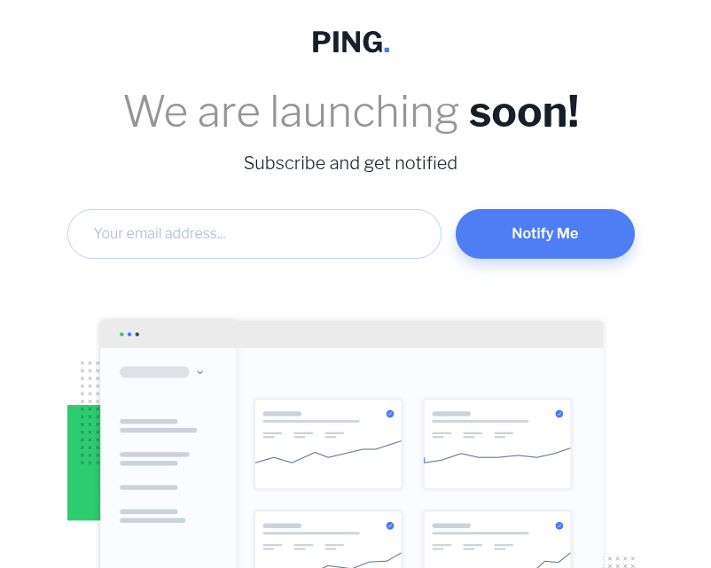

<h1 align="center">

My Solution to the [Ping Coming Soon Page](https://www.frontendmentor.io/challenges/ping-single-column-coming-soon-page-5cadd051fec04111f7) challenge.

</h1>

## Preview



## Overview

The goal was to build a responsive coming soon page featuring an email subscription form and an accessible validation experience.

The project includes:

- Ping logo.
- Coming soon announcement.
- Email subscription form.
- Email validation and error messages.
- Accessible submission confirmation for the demo.
- Dashboard illustration.
- Social media links.
- Responsive layouts for mobile and desktop.

<div align="center">

## Links

[View Live Project](https://yovanidosh.github.io/FmSoLuTiOns/challenges/ping-coming-soon-page-master/)

</div>

## What I Learned

In this project, I learned how to:

- Build an accessible form with an associated `<label>`.
- Validate email addresses using the native `email` input type.
- Check form validity through `validity.valid`.
- Display error messages using `aria-live`.
- Identify invalid fields using `aria-invalid`.
- Use `novalidate` to handle validation messages with custom JavaScript.
- Manage visual form states with CSS classes.
- Create responsive layouts using CSS Grid and Flexbox.
- Adapt typography with `clamp()`.
- Create social media icons using inline SVG.
- Style interactive states with `:hover`, `:focus-visible`, and `:active`.
- Maintain consistent colors using CSS custom properties.
- Respect reduced-motion preferences with `prefers-reduced-motion`.

## Featured Code

### Email Validation and Submission Confirmation

```javascript
form.addEventListener('submit', (event) => {
  event.preventDefault();

  if (!email.validity.valid) {
    showError();
    email.focus();
    return;
  }

  clearError();
  form.reset();
  successMessage.hidden = false;
});
```

The browser's native validation checks whether the email field contains a valid address. When validation succeeds, the form is reset and a confirmation message is displayed. Since this is a demo, no actual subscription is registered.

### Accessible Error State

```javascript
function showError() {
  form.classList.add('has-error');
  email.setAttribute('aria-invalid', 'true');
  errorMessage.textContent = 'Please provide a valid email address';
}
```

The `has-error` class changes the input's appearance, while `aria-invalid` communicates the invalid state to assistive technologies.

### Dynamic Confirmation Message

```javascript
email.addEventListener('input', () => {
  successMessage.hidden = true;

  if (form.classList.contains('has-error') && email.validity.valid) {
    clearError();
  }
});
```

The confirmation message disappears when the user starts editing the email field again. If the form is displaying an error, correcting the email also clears the error state.

```javascript
function showError() {
  form.classList.add('has-error');
  email.setAttribute('aria-invalid', 'true');
  errorMessage.textContent = 'Please provide a valid email address';
}
```

The `has-error` class changes the input's appearance, while `aria-invalid` communicates the field's invalid state to assistive technologies.

## Accessibility

The project includes:

- Semantic HTML.
- An accessible label for the email field.
- Dynamic error announcements using `aria-live`.
- `aria-invalid` to communicate validation errors.
- Alternative text for informative images.
- Accessible labels for social navigation and links.
- Visible keyboard focus indicators.
- A logical heading hierarchy.
- A status message announced to assistive technologies.
- Support for `prefers-reduced-motion`.

## Responsive Design

On mobile:

- The form uses a single-column layout.
- The input and button fill the available width.
- Typography and spacing adapt to smaller screens.

On desktop:

- The email field and button appear in the same row.
- The content remains centered within a maximum width.
- The dashboard illustration preserves its aspect ratio.
- Spacing adapts to shorter desktop viewports.

## Technologies Used

- HTML5
- CSS3
- JavaScript
- Flexbox
- CSS Grid
- Media Queries
- CSS Custom Properties
- SVG
- Google Fonts — Libre Franklin

<div align="center">

## Author

[Frontend Mentor](https://www.frontendmentor.io/profile/YovaniDosh)

[LinkedIn](https://www.linkedin.com/in/johanxt/)

</div>