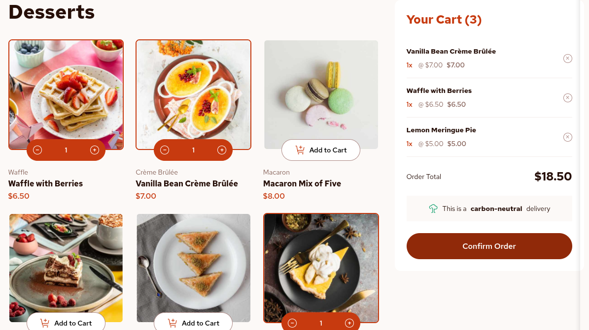

<h1 align="center">

My Solution to the: [Product List with Cart](https://www.frontendmentor.io/challenges/product-list-with-cart-5MmqLVAp_d) challenge.

</h1>

## <div align="center">Preview</div>



## <div align="center">Overview</div>

A responsive dessert shopping interface that allows users to browse products, manage cart quantities, review order totals, and confirm their selection through an accessible dialog.

The project focuses on semantic HTML, responsive layouts, DOM manipulation, and accessible interaction patterns using vanilla JavaScript.

## <div align="center">Links</div>

<div align="center">

[View Live Project](https://yovanidosh.github.io/FmSoLuTiOns/challenges/product-list-with-cart-main/)
</div>

## <div align="center">Technologies Used</div>

- HTML5 semantic elements
- CSS3 custom properties
- Vanilla JavaScript
- CSS Grid and Flexbox
- Responsive images with `<picture>`
- Local variable font: Red Hat Text
- Mobile-first responsive design
- BEM naming convention
- Native HTML `<dialog>` element
- Event delegation and `data-action` attributes
- `Map` for cart state management
- `Intl.NumberFormat` for currency formatting

## <div align="center">What I Learned</div>

- Managing shopping cart state with JavaScript's `Map` object.
- Rendering product cards and cart contents dynamically.
- Keeping product quantities, item subtotals, and order totals synchronized.
- Using `<picture>` and responsive image sources for different screen sizes.
- Implementing an order confirmation dialog with the native `<dialog>` element.
- Handling user interactions through event delegation and `data-action` attributes.
- Formatting currency values with `Intl.NumberFormat`.
- Improving accessibility with semantic HTML, keyboard focus indicators, and accessible button labels.
- Organizing responsive styles with CSS Grid, Flexbox, and CSS custom properties.
- Reducing unsafe HTML insertion risks by escaping dynamic text before rendering it.

## <div align="center">Featured Code</div>

### Cart State Management

```javascript
const cart = new Map();

function getQuantity(productIndex)
{
  return cart.get(productIndex) ?? 0;
}
```

Using a `Map` allows each product to be associated with its selected quantity, making cart updates and item removal straightforward.

### Responsive Product Images

```html
<picture>
  <source media="(min-width: 64rem)" srcset="...">
  <source media="(min-width: 40rem)" srcset="...">
  
</picture>
```

The `<picture>` element allows the browser to select an image appropriate for the current viewport.

## <div align="center">Accessibility</div>

- Semantic HTML landmarks and headings.
- Accessible names for interactive controls.
- Visible keyboard focus indicators.
- Native dialog behavior for order confirmation.
- Alternative text for meaningful product images.
- Reduced-motion preferences supported in CSS.

## <div align="center">Responsive Design</div>

The layout adapts to mobile, tablet, and desktop screens using CSS Grid, Flexbox, responsive images, and media queries.

- **Mobile:** Single-column product layout.
- **Tablet:** Two-column product grid.
- **Desktop:** Three-column product grid alongside the shopping cart.

## <div align="center">Author</div>

<div align="center">

[Frontend Mentor](https://www.frontendmentor.io/profile/YovaniDosh)

[LinkedIn](https://www.linkedin.com/in/johanxt/)

</div>