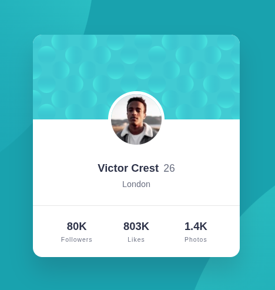

<h1 align="center">

This is my solution to the [Profile Card Component](https://www.frontendmentor.io/challenges/profile-card-component-cfArpWshJ) challenge.

</h1>

<div align="center">

## Preview



</div>

<div align="center">

## Overview

</div>

The goal was to build a responsive profile card while following the design provided by Frontend Mentor.

The card includes:

- Decorative top background.
- Overlapping avatar.
- User's name and age.
- Location.
- Follower count.
- Number of likes.
- Number of photos.
- Background with decorative elements.
- Fully responsive design.

<div align="center">

## Links

[View Live Project](https://yovanidosh.github.io/FmSoLuTiOns/challenges/profile-card-component-main/)

## Technologies Used

</div>

- HTML5
- CSS3
- CSS Grid
- BEM methodology
- Media queries
- Mobile-first design

<div align="center">

## What I Learned

</div>

In this project, I learned how to:

- Create backgrounds using multiple images with `background`.
- Combine multiple `background-image` layers.
- Position decorative images independently of the content.
- Overlap an avatar between two sections.
- Use `position: relative` as a reference for positioned elements.
- Horizontally center an element using `left: 50%`.
- Combine `left: 50%` with `transform: translate(-50%, -50%)`.
- Create perfectly circular images using `border-radius: 50%`.
- Use `aspect-ratio` to maintain proportions.
- Use `object-fit: cover`.
- Center components with CSS Grid and `place-items: center`.
- Create three equal columns using CSS Grid.
- Build the project following a mobile-first strategy.

<div align="center">

## Featured Code

</div>

### Overlapping Avatar

```css
.profile-card__content {
  position: relative;
}

.profile-card__avatar {
  position: absolute;
  top: 0;
  left: 50%;
  width: 6rem;
  aspect-ratio: 1;
  border: 0.35rem solid var(--color-white);
  border-radius: 50%;
  object-fit: cover;
  transform: translate(-50%, -50%);
}
```

This technique places the avatar precisely between the top image and the card content.

### Multiple Backgrounds

```css
body {
  background:
    url("../../../assets/images/bg-pattern-top.svg")
    top -25rem left -30rem / 45rem
    no-repeat,
    url("../../../assets/images/bg-pattern-bottom.svg")
    bottom -25rem right -32rem / 45rem
    no-repeat,
    var(--color-cyan);
}
```

I learned that CSS allows multiple images and a background color to be combined within a single `background` property.

This avoids creating HTML elements exclusively for decoration.

<div align="center">

## Accessibility

</div>

The project includes:

- Semantic HTML.
- Use of `<main>` and `<article>`.
- Descriptive alternative text for the avatar.
- Decorative images with `alt=""`.
- Heading hierarchy.

<div align="center">

## Responsive Design

</div>

The project was built following a mobile-first strategy.

The card's main structure remains consistent across devices because the component has a controlled maximum width.

On larger screens, the main adjustment is the positioning of the decorative background elements.

This keeps the component consistent without introducing unnecessary breakpoints.

<div align="center">

## Author

[Frontend Mentor](https://www.frontendmentor.io/profile/YovaniDosh)

[LinkedIn](https://www.linkedin.com/in/johanxt/)

</div>