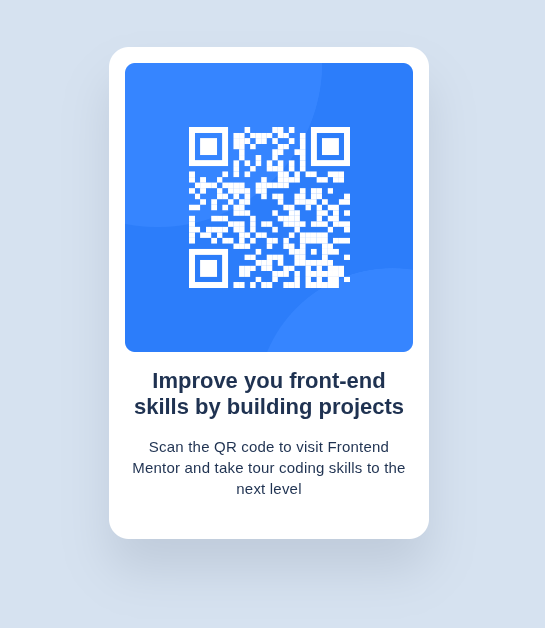

<h1 style="text-align: center">

My solution to the [QR Code Component challenge by Frontend Mentor](https://www.frontendmentor.io/challenges/qr-code-component-iux_sIO_H).

</h1>

## Preview

## Links

[View Live Project](https://yovanidosh.github.io/FmSoLuTiOns/challenges/qr-code-component-main/)

## Technologies Used

* Semantic HTML5
* CSS3
* Flexbox
* CSS Custom Properties
* Mobile-first design
* Responsive design

## What I Learned

During this challenge, I practiced:

* Building a card component using semantic HTML.
* Centering a card horizontally and vertically with Flexbox.
* Using `min-height: 100vh`.
* Limiting a component's width with `max-width`.
* Understanding the CSS box model.
* Using CSS custom properties to organize colors.
* Creating rounded corners.
* Working with `padding` and `margin`.
* Adapting a component to mobile devices.
* Understanding the importance of alternative text for images.

## Author

[Frontend Mentor](https://www.frontendmentor.io/profile/YovaniDosh)

[LinkedIn](https://www.linkedin.com/in/johanxt/)

