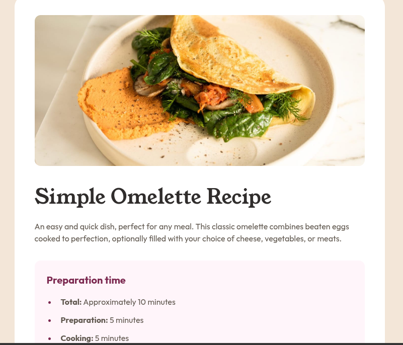

<h1 align="center">

This is my solution to the [Recipe Page](https://www.frontendmentor.io/challenges/recipe-page-KiTsR8QQKm) challenge.

</h1>

<div align="center">

## Preview



</div>

<div align="center">

## Links

[View Live Project](https://yovanidosh.github.io/FmSoLuTiOns/challenges/recipe-page-main/)

## Technologies Used

</div>

- HTML5
- CSS3
- Flexbox / Grid
- Semantic lists
- HTML tables
- Media queries
- Local fonts
- BEM methodology

<div align="center">

## What I Learned

</div>

In this project, I learned how to:

- Use semantic HTML for editorial content.
- Divide long content using `<section>`.
- Use `<aside>` for supplementary information.
- Create ordered and unordered lists.
- Customize list markers with `::marker`.
- Use `<strong>` to highlight important information.
- Create a semantic table using `<table>`, `<tr>`, `<th>`, and `<td>`.
- Use `scope="row"` to improve table accessibility.
- Create dividers using `border-bottom`.
- Design a mobile version first, without an outer card.
- Transform the page into a centered card for desktop.
- Extract reusable components for content, lists, and tables.

<div align="center">

## Featured Code

</div>

### Custom Markers

```css
.recipe-list li::marker {
  color: var(--color-brown-800);
  font-weight: 700;
}
```

### Semantic Table

```html
<tr>
  <th scope="row">Calories</th>
  <td>277kcal</td>
</tr>
```

<div align="center">

## Accessibility

</div>

- Image with alternative text.
- Correct heading hierarchy.
- Semantic lists.
- Table with headers.
- Content organized into sections.

<div align="center">

## Author

[Frontend Mentor](https://www.frontendmentor.io/profile/YovaniDosh)

[LinkedIn](https://www.linkedin.com/in/johanxt/)

</div>