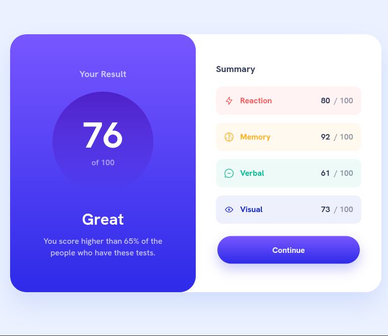

<h1 align="center">

Solution to the [Results Summary Component](https://www.frontendmentor.io/challenges/results-summary-component-CE_K6s0maV) challenge.

</h1>

<div align="center">

## Preview



</div>

<div align="center">

## Overview

</div>

The goal was to build a responsive card displaying:

- Overall score.
- Result evaluation.
- Category summary.
- Distinct icons and colors.
- Continue button.
- Data rendered with JavaScript.

<hr>

<div align="center">

[View Live Project](https://yovanidosh.github.io/FmSoLuTiOns/challenges/results-summary-component-main)

<hr>

## Technologies Used

</div>

- Semantic HTML5
- CSS3
- CSS Grid
- Flexbox
- CSS Variables
- CSS Custom Properties
- Mobile-first design
- Responsive design
- Local fonts
- BEM methodology
- JavaScript ES Modules
- Gradients
- Animations
- Media queries

<div align="center">

## What I Learned

</div>

- Separating data from the interface.
- Importing information between JavaScript modules.
- Inserting dynamic elements with `innerHTML`.
- Creating visual variants based on a category.
- Using linear gradients.
- Creating a perfect circle with `aspect-ratio`.

```css
.score-circle {
    aspect-ratio: 1;
    border-radius: 50%;
}
```

- Adding animations with `@keyframes`.
- Respecting `prefers-reduced-motion`.
- Creating reusable score components.
- Converting a mobile layout into two columns.
- Maintaining a scalable structure.
- Generating components with `map()`.

```js
summaryList.innerHTML = results
    .map(createSummaryItem)
    .join("");
```

<div align="center">

## Author

[Frontend Mentor](https://www.frontendmentor.io/profile/YovaniDosh)

[LinkedIn](https://www.linkedin.com/in/johanxt/)

</div>