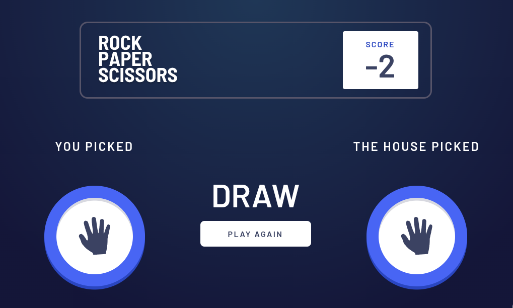

<h1 align="center">
  My Solution to the <a href="https://www.frontendmentor.io/challenges/rock-paper-scissors-game-pTgwgvgH">Rock, Paper, Scissors</a> Challenge
</h1>

<div align="center">

## Preview



## Links

[View Live Project](https://yovanidosh.github.io/FmSoLuTiOns/challenges/rock-paper-scissors-master/)

## Technologies Used

</div>

- Semantic HTML5
- Sass (SCSS)
- CSS3
- JavaScript
- CSS Grid
- Flexbox
- HTML `<dialog>` and `<output>` elements
- ARIA attributes
- Responsive Design
- Mobile-First Design
- Barlow Semi Condensed (local font)

<div align="center">

## Overview

</div>

The goal was to build a responsive Rock, Paper, Scissors game against the computer using vanilla JavaScript.

The interface includes:

- Separate scoreboards for the player and the computer.
- Three buttons to choose rock, paper, or scissors.
- Random opponent selections.
- A visible result for each round: win, loss, or draw.
- A **Continue** button to manually advance after each round.
- A best-of-three-wins match that ends when either the player or the computer reaches three points.
- A final modal displaying emojis, a *You win* or *You lose* message, and a **Play again** button.
- A modal dialog containing the game rules.
- A mobile-first layout adapted for desktop screens.

<div align="center">

## What I Learned

</div>

Through this project, I learned how to:

- Represent game rules using JavaScript objects.
- Select a random element from an array.
- Separate game logic into small functions with clearly defined responsibilities.
- Update scoreboards and display the result of each round.
- Detect the end of a match when either participant reaches three wins.
- Reuse a function to render both the player's and the opponent's choices.
- Switch between views using the `hidden` property.
- Use the native `<dialog>` element for rules and results modals.
- Create reusable circular buttons with Sass.
- Adapt the game board using CSS Grid.
- Manage keyboard focus during round transitions and when a match ends.
- Improve navigation for users who rely on assistive technologies.

<div align="center">

## Featured Code

</div>

### Game Rules as Data

```javascript
const winningMoves = {
  rock: "scissors",
  paper: "rock",
  scissors: "paper",
};

function getRoundResult(playerChoice, opponentChoice) {
  if (playerChoice === opponentChoice) {
    return "draw";
  }

  return winningMoves[playerChoice] === opponentChoice
    ? "win"
    : "lose";
}
```

The `winningMoves` object acts as a rule lookup table. The function first checks for a draw, then determines whether the player's choice defeats the computer's choice by consulting the object.

### Round Results and Progression

Each round displays both participants' choices and a message indicating whether the player won, lost, or drew. The **Continue** button lets the player advance to the next round without relying on an automatic delay.

When either the player or the computer reaches three points, the match ends and the final result appears in the appropriate dialog.

<div align="center">

## Accessibility

</div>

The project includes:

- Semantic HTML.
- Native buttons for all interactive actions.
- Dynamic alternative text to identify the player's and opponent's choices.
- Live score updates announced through `aria-live="polite"`.
- Score values represented using `<output>` elements.
- Focus management when displaying results, continuing a match, and restarting the game.
- Separate native modal dialogs for the rules and final result.
- An accessible name for the rules dialog using `aria-labelledby`.
- Clearly visible `:focus-visible` states.
- Support for `prefers-reduced-motion`.
- Empty `src` attributes removed from dynamic images to prevent unnecessary requests.

<div align="center">

## Responsive Design

</div>

The project follows a mobile-first approach.

**On mobile devices:**

- The scoreboard uses a compact layout.
- The player and computer scores are displayed separately.
- The choices are arranged around a flexible triangular layout.
- Both choices and the round result remain visible until the player selects **Continue**.
- The final result appears in a separate modal.
- The rules dialog occupies the full screen.

**On desktop screens:**

- The scoreboard and game board increase in size.
- The player's and opponent's choices are arranged in two columns, with the round result centered.
- The Rules button aligns with the right edge.
- The rules dialog appears as a centered card.

<div align="center">

## Author

[Frontend Mentor](https://www.frontendmentor.io/profile/YovaniDosh)

[LinkedIn](https://www.linkedin.com/in/johanxt/)

</div>