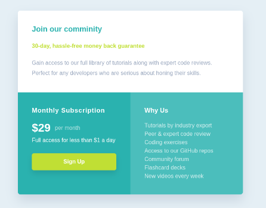

 <h1 align="center">

This is my solution to the [Single Price Grid Component](https://www.frontendmentor.io/challenges/single-price-grid-component-0Q7MGTPWv) challenge.

</h1>

<div align="center">

## Preview



</div>

<div align="center">

## Overview

</div>

The goal was to build a fully responsive pricing component.

The interface includes:

- Community introduction.
- Monthly pricing.
- Subscription description.
- Sign-up button.
- List of benefits.
- Mobile-first layout.
- Two-column layout for larger screens.

<div align="center">

## Links

[View Live Project](https://yovanidosh.github.io/FmSoLuTiOns/challenges/single-price-grid-component-master/)

## Technologies Used

</div>

- HTML5
- CSS3
- CSS Grid
- Grid Template Areas
- Media Queries
- Flexbox
- Responsive Design
- Mobile-first workflow

<div align="center">

## What I Learned

</div>

In this project, I learned how to:

- Build a responsive component using CSS Grid.
- Use `grid-template-areas`.
- Create a mobile-first layout.
- Transform a vertical structure into a two-column composition.
- Maintain the same HTML structure across mobile and desktop layouts.
- Design an accessible call to action (CTA).
- Apply `:hover`, `:focus-visible`, and `:active` states.
- Create subtle shadows.
- Use a semantic list to present benefits.
- Maintain sufficient contrast between backgrounds and text.
- Work with plain CSS again after using Sass and Less.

<div align="center">

## Featured Code

</div>

### Grid Areas

```css
.pricing-card {
  grid-template-areas:
    "intro intro"
    "subscription why";
}
```

Grid areas allow the three sections to be arranged without modifying the HTML structure.

```css
.pricing-card__intro {
  grid-area: intro;
}

.pricing-card__subscription {
  grid-area: subscription;
}

.pricing-card__why {
  grid-area: why;
}
```

Each section is assigned to its corresponding grid area, making the layout easier to organize and maintain.

<div align="center">

## Accessibility

</div>

The project includes:

- Semantic HTML.
- Proper heading hierarchy.
- A semantic list for the benefits.
- Keyboard navigation.
- Visible `:focus-visible` states.
- An interactive call-to-action button.
- Sufficient visual contrast.

<div align="center">

## Responsive Design

</div>

The project was built using a mobile-first approach.

On mobile devices:

- The three sections are stacked vertically.
- The content maintains a natural reading flow.
- The button occupies the available width.

On larger screens:

- The introduction spans the entire first row.
- The subscription and *Why Us* sections are arranged in two columns.
- Both columns maintain balanced proportions.

<div align="center">

## Author

[Frontend Mentor](https://www.frontendmentor.io/profile/YovaniDosh)

[LinkedIn](https://www.linkedin.com/in/johanxt/)

</div>