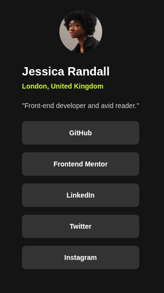

<h1 align="center">

This is my solution to the [Social Links Profile](https://www.frontendmentor.io/challenges/social-links-profile-UG32l9m6dQ) challenge.

</h1>

<div align="center">

## Preview



</div>

<div align="center">

## Overview

</div>

The goal was to build a responsive social profile card.

The interface includes:

- User avatar.
- Name.
- Location.
- Personal description.
- Social media links.
- Hover, focus, and active states.
- Centered responsive layout.

<div align="center">

## Links

[View Live Project](https://yovanidosh.github.io/FmSoLuTiOns/challenges/social-links-profile-main/)

## Technologies Used

</div>

- Semantic HTML
- Less
- CSS Grid
- Flexbox
- npm
- BEM methodology
- Mobile-first design
- Responsive design

<div align="center">

## What I Learned

</div>

In this project, I learned how to:

- Install Less using npm.
- Configure Less as a development dependency.
- Compile `.less` files into `.css`.
- Automate compilation during development.
- Create variables using `@`.
- Import Less files using `@import`.
- Organize styles into separate files.
- Use nesting in Less.
- Use `&` to reference the current selector.
- Understand the basic differences between Sass and Less.
- Create a centered card using CSS Grid.
- Create circular avatars with `border-radius: 50%`.
- Use `aspect-ratio`.
- Create a vertical list of links.
- Create smooth transitions.
- Maintain a responsive design without unnecessary media queries.
- Evaluate when a dependency such as Bootstrap does not add value to a project.

<div align="center">

## Featured Code

</div>

### Less Variables

```less
@color-background: hsl(0, 0%, 8%);
@color-card: hsl(0, 0%, 12%);
@color-green: hsl(75, 94%, 57%);
```

Unlike Sass, which uses `$`, Less uses `@` to declare variables.

### Nesting

```less
.profile-card {
  &__links {
    a {
      &:hover,
      &:focus-visible {
        background: @color-green;
        color: @color-background;
      }
    }
  }
}
```

Nesting allows styles to be organized according to the component structure without repeatedly writing the complete selector.

### Responsive Card

```less
.profile-card {
  width: min(100%, 24rem);
}
```

Thanks to `min()`, the card adapts to small screens without growing excessively on larger screens.

<div align="center">

## Accessibility

</div>

The project includes:

- Semantic HTML.
- Keyboard navigation.
- Links implemented with `<a>`.
- `:focus-visible` states.
- Alternative text for the avatar.
- Contrast between text and background.
- Visible interactive states.

<div align="center">

## Responsive Design

</div>

The project was built following a mobile-first strategy.

The card uses a flexible width with a maximum limit, allowing it to maintain virtually the same structure across mobile devices and desktop screens.

This made it possible to avoid unnecessary media queries.

<div align="center">

## Author

[Frontend Mentor](https://www.frontendmentor.io/profile/YovaniDosh)

[LinkedIn](https://www.linkedin.com/in/johanxt/)

</div>