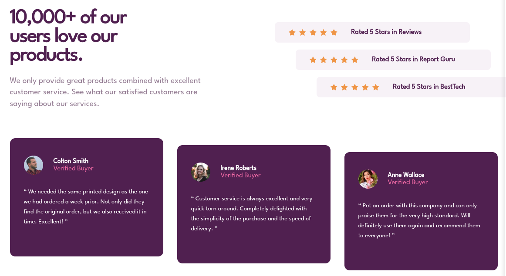

# <h1 align="center">My Solution to the [Social Proof Section](https://www.frontendmentor.io/challenges/social-proof-section-6e0qTv_bA) challenge.</h1>

## <h2 align="center">Preview</h2>



## <h2 align="center">Overview</h2>

The goal of this project was to build a responsive social proof section featuring customer ratings and testimonials.

The project includes:

- Main introduction section.
- Three five-star ratings.
- Three customer testimonials.
- User avatars.
- Staggered card layouts on desktop.
- Responsive design for different screen sizes.


<div align="center">


[View Live Project](https://yovanidosh.github.io/FmSoLuTiOns/challenges/social-proof-section-master/)

</div>

## <h2 align="center">What I Learned</h2>

In this project, I learned how to:

- Build reusable card components using CSS classes.
- Create circular avatars with `border-radius`.
- Select elements using `nth-child()`.
- Offset elements using `transform`.
- Create staggered layouts.
- Use `minmax()` with CSS Grid.
- Structure testimonial content semantically with `blockquote`.
- Follow a mobile-first development approach.

## <h2 align="center">Featured Code</h2>

```css
.rating:nth-child(2) {
  margin-left: 3rem;
}

.rating:nth-child(3) {
  margin-left: 6rem;
}

.testimonial:nth-child(2) {
  transform: translateY(1rem);
}

.testimonial:nth-child(3) {
  transform: translateY(2rem);
}
```

Using `nth-child()`, I created two staggered effects for the rating and testimonial cards without removing the elements from the document's normal flow.

## <h2 align="center">Accessibility</h2>

The project includes:

- Semantic HTML.
- Appropriate use of `<main>`, `<section>`, and `<article>`.
- Testimonial content structured with `<blockquote>`.
- Alternative text for user avatars.
- Ratings identified through ARIA attributes.
- A clear heading hierarchy.

## <h2 align="center">Responsive Design</h2>

The project was built using a mobile-first approach.

On smaller screens, all elements are displayed in a single column. On desktop, CSS Grid distributes the introduction, ratings, and testimonials into a structured layout.

## <h2 align="center">Technologies Used</h2>

- HTML5
- CSS3
- CSS Grid
- Flexbox
- CSS Custom Properties
- BEM
- Media Queries
- Mobile-first design

<div align="center">

## Author

[Frontend Mentor](https://www.frontendmentor.io/profile/YovaniDosh)

[LinkedIn](https://www.linkedin.com/in/johanxt/)

</div>