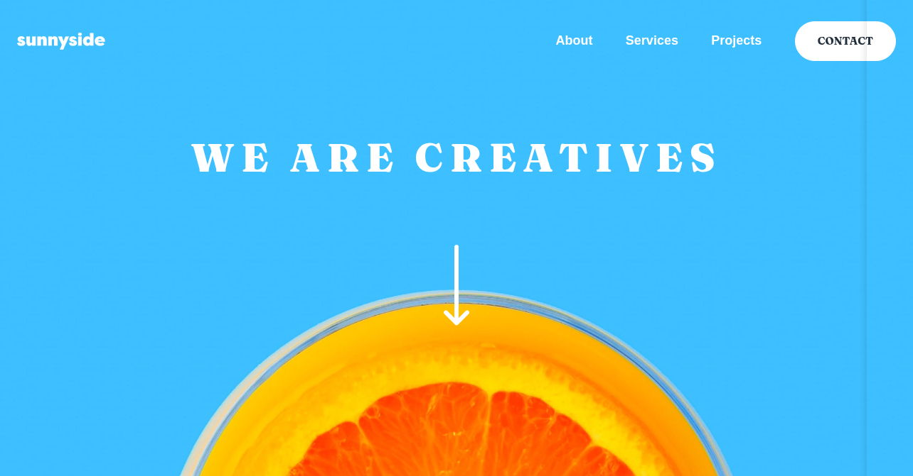

# <h1 align="center">My Solution to the [Sunnyside Agency Landing Page](https://www.frontendmentor.io/challenges/sunnyside-agency-landing-page-7yVs3B6ef) challenge.</h1>

## <h2 align="center">Preview</h2>



## <h2 align="center">Overview</h2>

The goal of this project was to build a responsive landing page for a creative agency while preserving the visual composition across mobile and desktop layouts.

The interface includes:

- Hero section with navigation and a visual scroll cue.
- JavaScript-powered mobile navigation menu.
- Introduction and services sections.
- Customer testimonials.
- Responsive image gallery using `<picture>`.
- Footer navigation and social links.

<div align="center">

## Links

[View Live Project](https://yovanidosh.github.io/FmSoLuTiOns/challenges/sunnyside-agency-landing-page-main/)

</div>

## <h2 align="center">What I Learned</h2>

In this project, I learned how to:

- Organize a long landing page into semantic sections.
- Use Sass to centralize colors, typography, and breakpoints.
- Serve different images based on the viewport using `<picture>` and `<source>`.
- Build an accessible mobile navigation menu without external dependencies.
- Synchronize visual states with `aria-expanded`.
- Restore focus when closing a menu with the `Escape` key.

## <h2 align="center">Featured Code</h2>

### Accessible Mobile Navigation

The mobile navigation menu synchronizes its visibility with the `aria-expanded` attribute, helping assistive technologies communicate its current state.

```javascript
function closeMenu() {
  menu.dataset.open = "false";
  toggleButton.setAttribute("aria-expanded", "false");
  toggleButton.setAttribute("aria-label", "Open navigation menu");
  toggleButton.focus();
}
```

This approach closes the menu, updates its accessible state and label, and returns keyboard focus to the toggle button.

## <h2 align="center">Accessibility</h2>

The project includes:

- Navigation landmarks with accessible names.
- A native button with `aria-expanded` and `aria-controls`.
- A button label that updates according to the menu state.
- Menu dismissal using the `Escape` key.
- Keyboard focus restoration after closing the menu.
- Visible `:hover` and `:focus-visible` states.
- Alternative text for informative images.
- Support for `prefers-reduced-motion`.

## <h2 align="center">Responsive Design</h2>

On mobile devices, the navigation appears as a dropdown panel, content sections stack vertically, and the image gallery uses two columns.

On desktop, the navigation remains visible, content sections use two-column layouts, and the gallery displays four images per row.

## <h2 align="center">Technologies Used</h2>

- Semantic HTML5
- Sass
- CSS3
- JavaScript
- CSS Grid
- Flexbox
- Responsive Images
- Media Queries
- ARIA

<div align="center">

## Author

[Frontend Mentor](https://www.frontendmentor.io/profile/YovaniDosh)

[LinkedIn](https://www.linkedin.com/in/johanxt/)

</div>