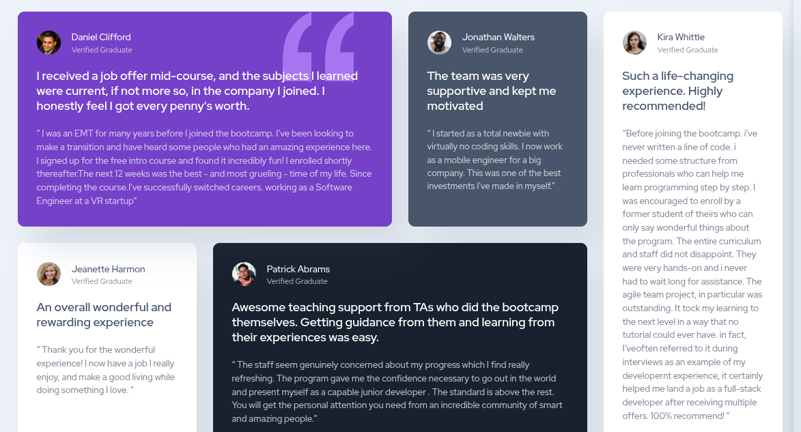

# <h1 align="center">My Solution to the [Testimonials Grid Section](https://www.frontendmentor.io/challenges/testimonials-grid-section-Nnw6J7Un7) challenge.</h1>

## <h2 align="center">Preview</h2>



## <h2 align="center">Overview</h2>

The goal of this project was to build a responsive testimonials section using CSS Grid.

The interface includes:

- Five testimonial cards.
- User avatars, names, and status labels.
- Main testimonials and supporting descriptions.
- Color variations for different cards.
- Mobile-first layout.
- Asymmetric grid layout on desktop.

<div align="center">

## Links

[View Live Project](https://yovanidosh.github.io/FmSoLuTiOns/challenges/testimonials-grid-section-main/)

</div>

## <h2 align="center">What I Learned</h2>

In this project, I learned how to:

- Build asymmetric layouts with CSS Grid.
- Use `grid-template-areas`.
- Position cards using `grid-area`.
- Create components with color variations.
- Combine CSS Grid and Flexbox.
- Create circular avatars with `border-radius`.
- Use `aspect-ratio` and `object-fit`.
- Preserve the HTML order across mobile and desktop layouts.
- Build layouts using a mobile-first approach.
- Use `blockquote` for testimonial content.

## <h2 align="center">Featured Code</h2>

### Testimonials Grid Layout

```css id="f9z1xk"
.testimonials {
  grid-template-columns:
    repeat(4, minmax(0, 1fr));

  grid-template-areas:
    "daniel daniel jonathan kira"
    "jeanette patrick patrick kira";
}
```

This layout allows selected cards to span multiple columns or rows while maintaining a clear and organized structure.

## <h2 align="center">Accessibility</h2>

The project includes:

- Semantic HTML.
- Appropriate use of `<article>` and `<blockquote>`.
- Alternative text for user avatars.
- A clear heading hierarchy.
- A mobile-first approach.
- CSS Grid and Flexbox for layout.
- Media queries for responsive behavior.

## <h2 align="center">Responsive Design</h2>

On mobile devices, the testimonials are displayed in a single column.

On desktop, CSS Grid rearranges the five cards into an asymmetric composition without modifying the HTML structure.

## <h2 align="center">Technologies Used</h2>

- HTML5
- CSS3
- CSS Grid
- Flexbox
- BEM
- Media Queries
- Mobile-first design

<div align="center">

## Author

[Frontend Mentor](https://www.frontendmentor.io/profile/YovaniDosh)

[LinkedIn](https://www.linkedin.com/in/johanxt/)

</div>